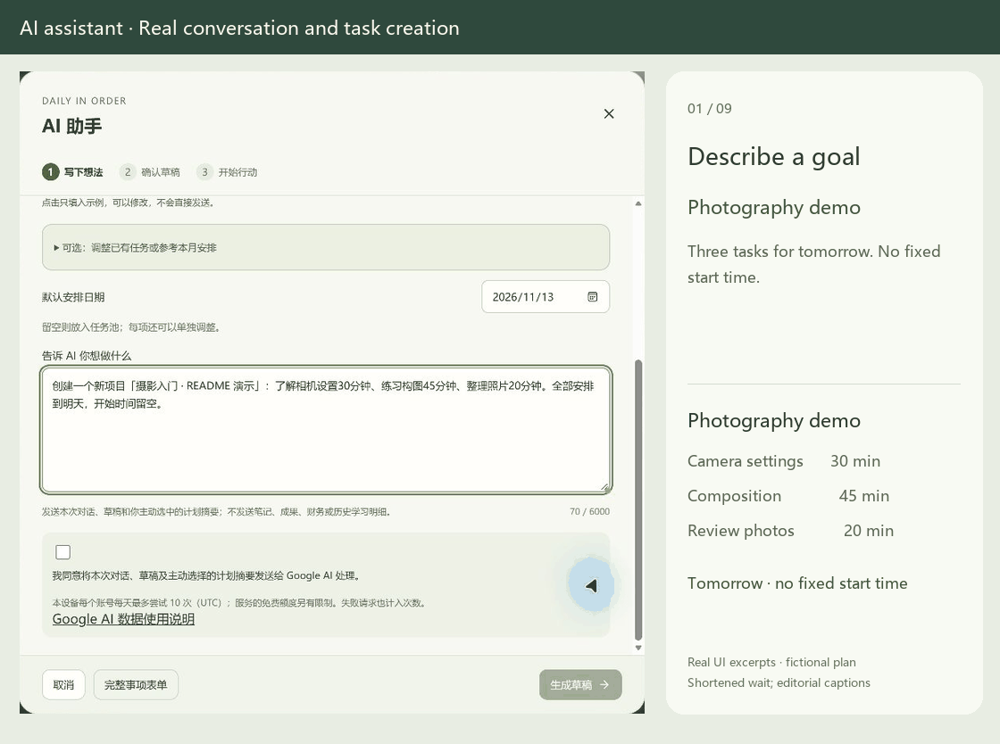
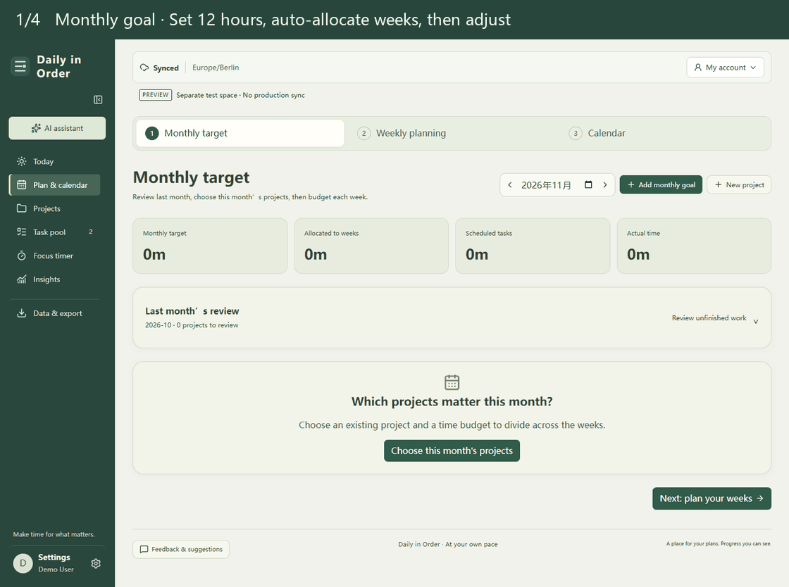
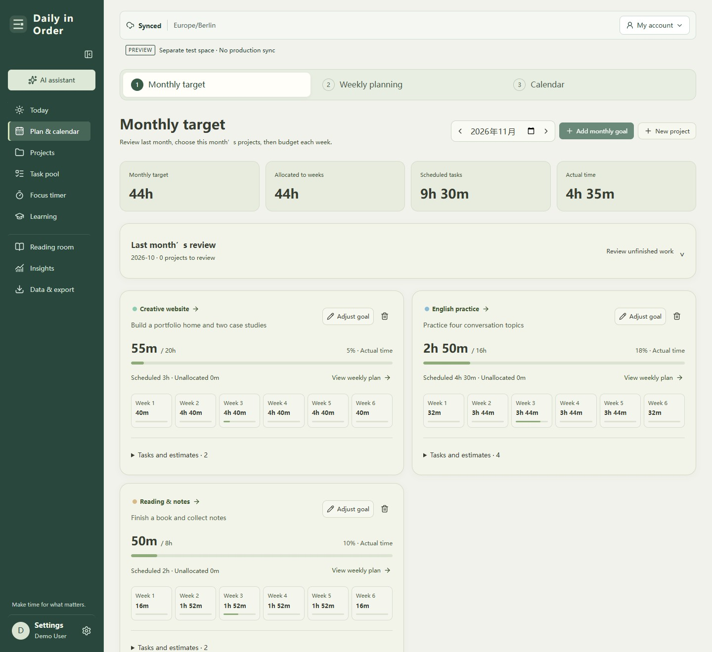
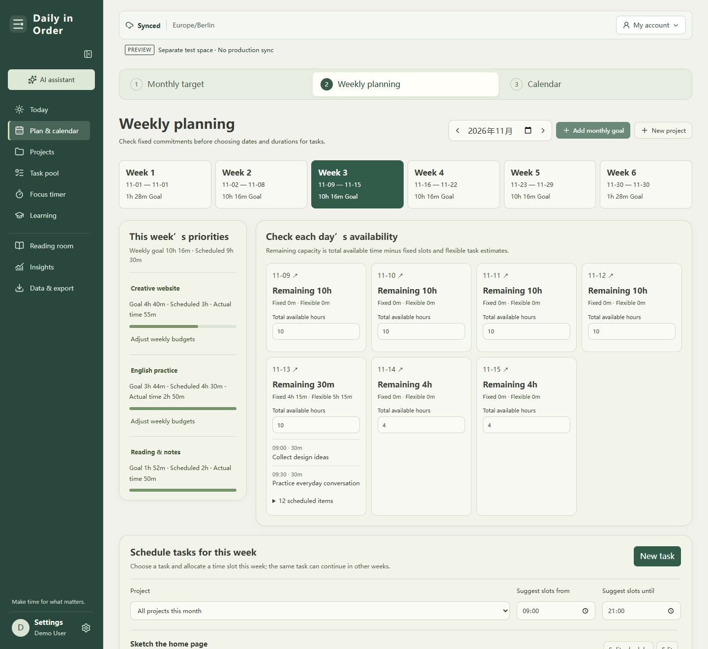
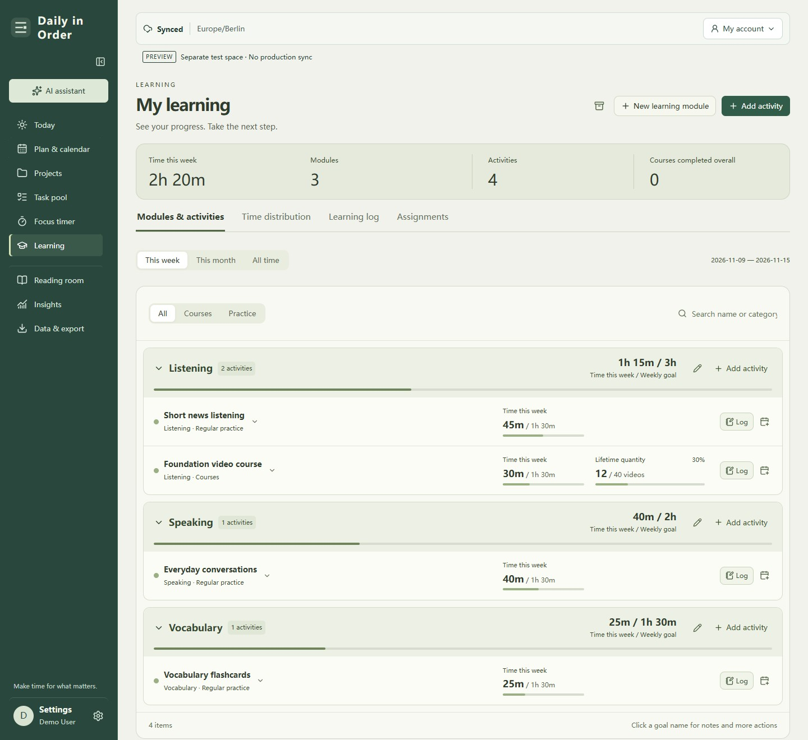
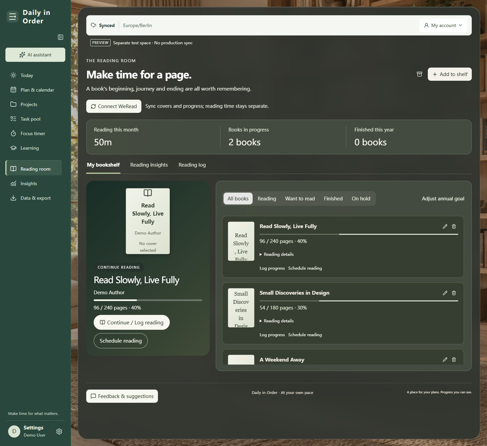

# Daily in Order · 日常有序

**Make room for what you want to do.**

From monthly goals to today's tasks: plan your time, focus on the work, and keep track of your progress in one workspace.

[Get started](https://personal-daily-organize.web.app/?lang=en) · [简体中文](README.md) · [Feedback](https://github.com/Kylie08ky/daily-in-order/issues)

Desktop first · 中文 / English / Deutsch · Installable web app

<table>
<tr>
<td width="50%" valign="top">
<strong>Today overview</strong> 

 Daily plans, project progress and notes.
</td>
<td width="50%" valign="top">
<strong>Daily timeline</strong> 

 Actual effort and future plans on one timeline.
</td>
</tr>
</table>

## Start with one goal

Want to finish a course, move a personal project forward, or make time for reading? Turn it into a project, then decide how much time to give it this week and today. Your plans can change without losing track of the effort you have already put in.

1. **Register and verify your email** to open your own workspace.
2. **Tell the AI assistant what you want to do.** Review the draft to create projects, tasks and schedules together, or add them manually.
3. **Start with one task today:** schedule it, start focusing, or record progress you have already made.

You do not need to configure everything at once. Enable learning, reading, habits, fitness and budgets as you need them.

## Turn a sentence into your first plan

> Tomorrow I'd like to start learning photography: 30 minutes on camera settings, 45 minutes practicing composition, and 20 minutes organizing photos. Keep them in one project and leave the start times open.

The assistant turns your ideas into an editable draft with linked projects, tasks and dates. Nothing is added until you review and confirm it, and you do not need to fill out the same plan again.

*Real AI interaction using a sample project. You can also ask the assistant to break down monthly and weekly plans, create reusable tasks, or revise the remaining work for an existing task.*

## Bring a monthly goal into your day

**Monthly goals → Weekly allocation → Daily plans → Focus → Review**

Choose the projects you want to work on this month and estimate the time they need. Allocate that time across weeks, then schedule tasks around fixed commitments and the time available each day.

Follow a 12-hour design goal through weekly allocation, daily scheduling, a timeline adjustment and a focus session.

<table>
<tr>
<td width="50%" valign="top">
<strong>Monthly goals</strong> 

 Set a time budget for each project and allocate it across weeks.
</td>
<td width="50%" valign="top">
<strong>Weekly planning</strong> 

 Plan around fixed commitments and each day’s availability.
</td>
</tr>
</table>

### One task can span several days

Plan two hours of a six-hour task this week and four hours next week, without creating duplicate tasks. Each session's actual effort stays linked to the original task.

- **Not sure when to start?** Choose a date and estimated duration, leaving the time flexible.
- **Have a specific time in mind?** Switch to the timeline and drag the block to adjust it.
- **Halfway through and need more time?** Re-estimate the remaining work and schedule what is left.
- **Have a regular practice you return to?** Keep a reusable entry and add it to a day when needed. Course-related tasks can stay available for a limited phase, too.

Moving future plans does not change past effort. Spending longer than estimated does not automatically mark a task complete.

### Record once, see progress where it belongs

Start a count-up or countdown timer from today's task and enter full-screen focus. Afterward, add the videos you completed, the page you reached, or a project outcome. You can also log progress manually without using the timer.

**An activity's time is counted once.** Daily tasks, learning, reading and projects display linked records. Adding a page number or an outcome does not add another copy of the time.

<table>
<tr>
<td width="50%" valign="top">
<strong>AI assistant</strong> 

 Describe a plan and review its draft before saving.
</td>
<td width="50%" valign="top">
<strong>Full-screen focus</strong> 

 A timer alongside a virtual incentive.
</td>
</tr>
</table>

*“Potential wealth” is a virtual incentive that grows with focus time. It is not real income.*

## Choose the modules you need

Scheduling and projects are the core. Add other modules to suit the way you work and live.

| What you want to do | Features |
| --- | --- |
| Follow your learning and course progress | Custom modules and activities, separate time and quantity tracking, weekly, monthly and all-time views |
| Remember where you left off in a book | A bookshelf, covers, current page and session history, with reading time and progress |
| Build routines and keep moving | Habit, sleep and workout logs, with optional daily intake and nutrition targets |
| Manage everyday spending | Custom accounts, budgets and currencies, with separate totals for each currency |
| See where your time went | Effort trends, project progress and focus history, with sources you can review and correct |
| Back up or take your records with you | JSON backup and restore, task CSV and calendar ICS import/export |

<table>
<tr>
<td width="50%" valign="top">
<strong>Learning modules &amp; activities</strong> 

 Weekly targets, actual time and course counts remain distinct.
</td>
<td width="50%" valign="top">
<strong>Reading room</strong> 

 A bookshelf, reading positions and this month’s effort.
</td>
</tr>
</table>

## Before you start

**Do I need to install anything?**

Open the [web app](https://personal-daily-organize.web.app/?lang=en), or install it on your desktop. Desktop is the primary supported experience. You can continue on a phone, but the mobile layout is still being refined.

**Can friends see my records?**

Each person signs in with their own account and has a separate workspace. Sharing the app link does not share your tasks or notes.

**Does it work offline?**

Initial loading and sign-in require a connection. Cached content is available offline; edits sync when the app is open and connected again. There is currently no cloud scheduler running after the app closes.

**Do I have to use AI?**

No. Manual entry and list input remain available. AI requires a connection and is subject to security verification and service quotas. Review suggested dates, durations and schedules before saving.

**Can I connect WeRead?**

The connection is currently being tested in preview and is not available in the hosted production app. It is intended for read-only cover and reading-progress synchronization, without importing reading time.

**How can I send feedback?**

Use **Settings → Feedback** in the app or open a [GitHub issue](https://github.com/Kylie08ky/daily-in-order/issues). Tell us what you wanted to do and where you got stuck. Remove personal information before attaching screenshots.

## Development and project resources

Designed and maintained by [Kylie](https://github.com/Kylie08ky). Built with React, TypeScript, Firebase and PWA support.

- [Run locally or deploy your own instance](docs/SETUP.en.md)
- [Tests](tests) · [Maintenance and releases](docs/MAINTENANCE.md)
- [WeRead connection guide](docs/WEREAD.md)
- [Demo media notes](docs/images/README.md): screenshots and walkthroughs use sample data, not personal records.

Change the interface language in Settings; your tasks and notes are not automatically translated. A full backup restore replaces the current workspace, so make a backup first.

No open-source license has been selected for this repository. Public source availability does not grant unrestricted redistribution or commercial-use permission. Third-party dependencies and assets retain their respective licenses.
