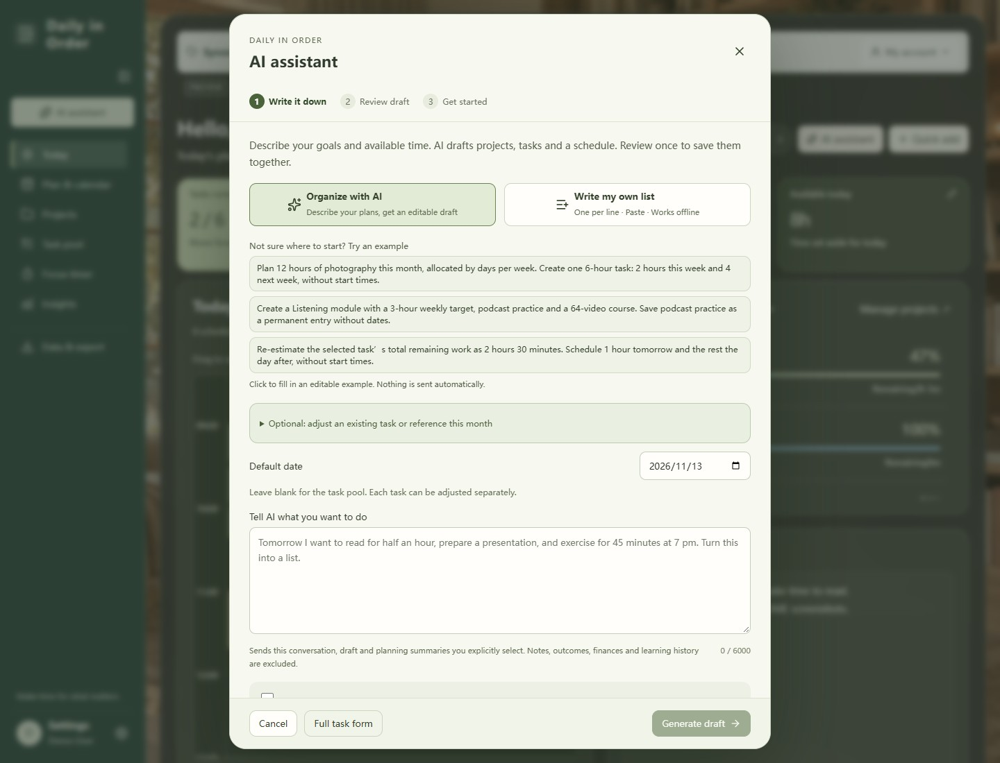
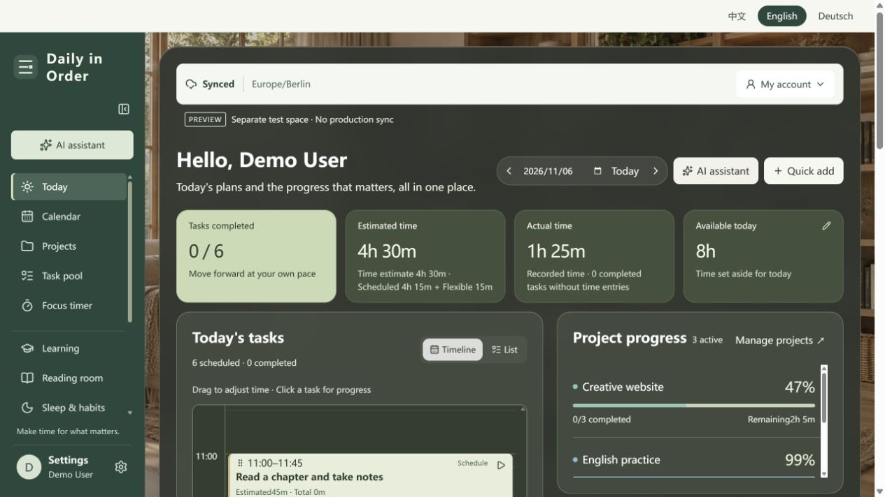
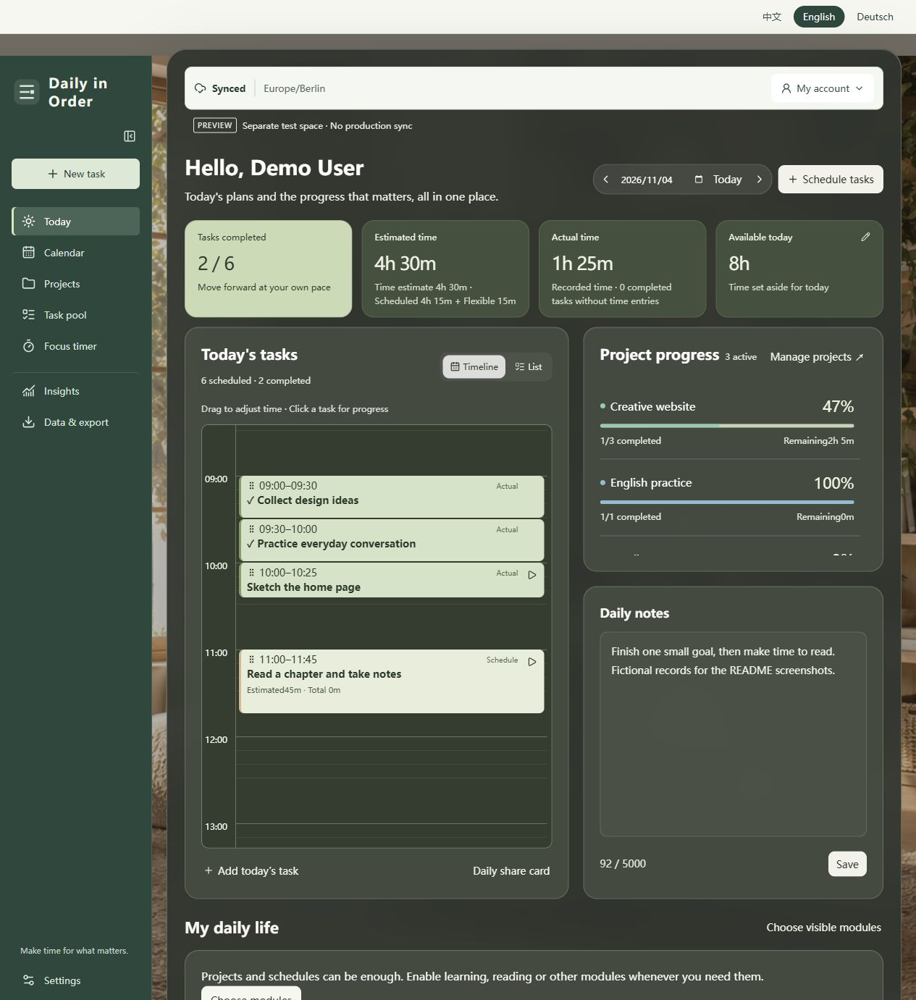
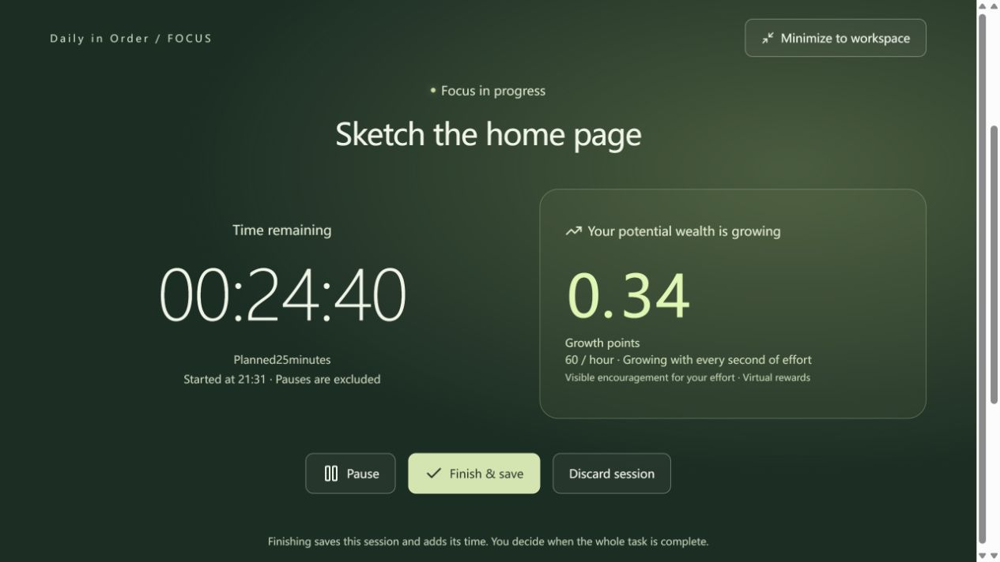
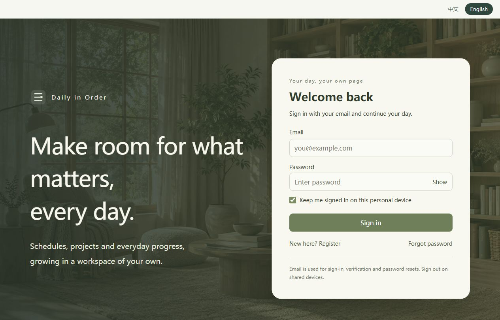
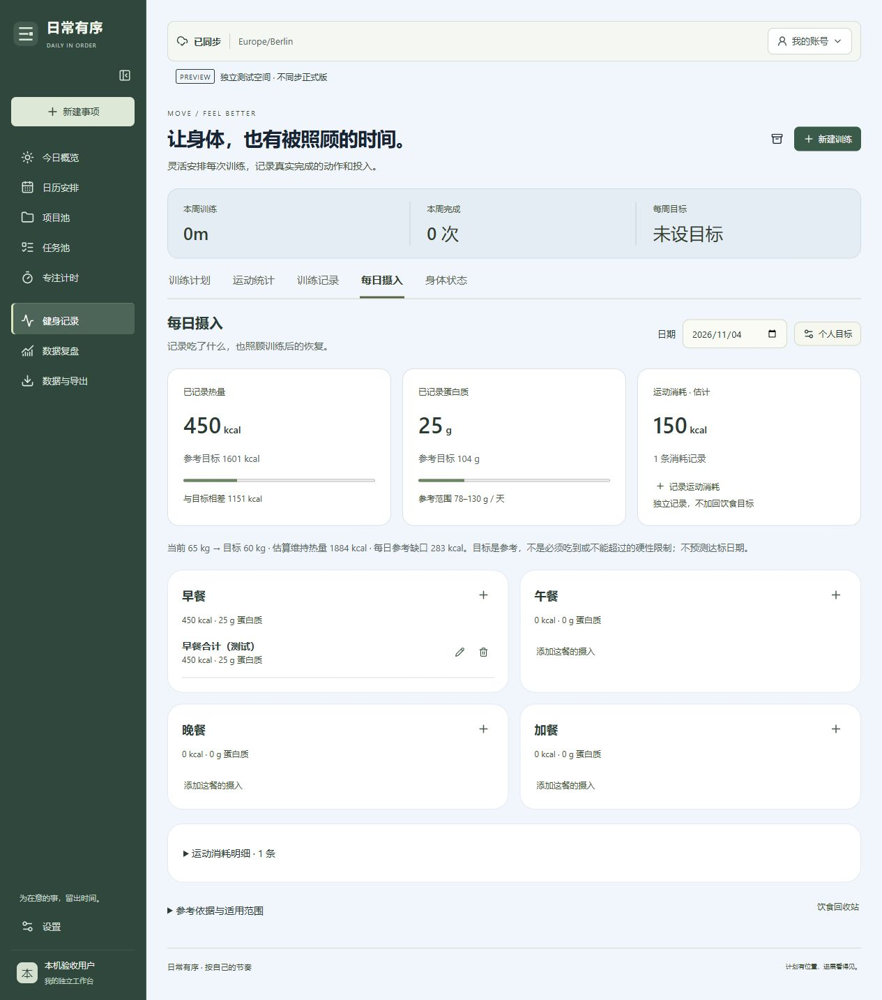

# Daily in Order · 日常有序

Make room for your goals. Keep track of the time you put in.

[简体中文](README.md) · **English**

[Try the app](https://personal-daily-organize.web.app/) · [Features](#features) · [Run locally](#run-locally) · [Deploy your own instance](#deploy-your-own-instance)

Daily in Order is a personal workspace with Chinese, English and German interfaces. Plan tasks, track focus sessions and review project progress, then enable learning, reading, habits, fitness and finance modules as needed. The interface uses a green palette and card layouts for desktop and mobile.

This repository contains application source, tests and deployment scripts. It does not include the author's or other users' workspace records, backups, account credentials or production configuration. The hosted app requires your own account; self-hosted installations should use their own Firebase project.

**v0.8.2 released:** Switch between Chinese, English and German beside the Settings heading; your choice is remembered on this device. The workspace no longer has a language bar at the top. Navigation scrolls independently, with avatar, name and Settings combined in one bottom entry. Promoted unchanged to production on 2026-11-06 after preview approval, without copying preview data.

**v0.8.3 preview:** Project modules start collapsed while keeping completion counts and progress visible. Click a module heading to expand or collapse it, or use Expand all / Collapse all. Adding a task opens its module. Expansion choices remain while navigating within the current workspace session. Production remains on v0.8.2.

**v0.8.4 preview:** Each project can use recorded time or task progress. Its overall, dashboard and module progress follow the same account-saved choice. Time progress is recorded duration divided by estimated duration for tasks with estimates, capped at 100%; tasks without estimates are excluded, and an empty estimate total prompts you to add estimates. Task progress retains the average task completion percentage. Switching does not change tasks, records or time statistics; older projects default to task progress. Production remains on v0.8.2.

**v0.8.5 preview:** Project header actions use compact horizontal buttons with single-line icon and text labels. With long project names or narrow windows, the action group moves below the heading instead of squeezing buttons into vertical tiles. Production remains on v0.8.2.

**v0.8.6 preview:** Move-up and move-down controls beside each module heading let you reorder all groups, including Unassigned, on desktop and mobile. The order is saved with the project and survives reloads without moving or changing its tasks. Production remains on v0.8.2.

**v0.9.0 preview:** Monthly goals let you select projects, set time budgets and optional outcomes, then split whole minutes proportionally by each week’s in-month days. Adjust weekly amounts or save an unallocated balance. Monthly and weekly tabs distinguish targets, scheduled task estimates and actual time. Schedule existing unscheduled tasks, update tasks in the selected week, add tasks or open the weekly calendar. Actuals reuse focus/manual records and recalculate after edits or deletions; no duplicate tasks are created. Cross-month weeks count only the selected month, and saved plans retain their original week-start setting. Production remains on v0.8.2.

**v0.13.0 preview:** Schedule one task across days and weeks: a six-hour estimate can have two hours this week and four next week, always retaining one task ID. Open **Split schedule** from a task’s calendar button, task details or Weekly planning. For an existing full-length plan, adjust its duration first, then add another slot. Start times are optional; total, allocated and unallocated time are shown separately. Move, resize, edit or remove individual slots. Calendar and monthly/weekly scheduled totals use the slots in that date range; focus/manual records still accumulate on the original task, with no invented actual time. Finishing focus replaces only its linked slot; future slots remain. Removing a slot retains actual records. Full JSON backups preserve links; ICS exports individual calendar slots (reimporting ICS is not a relationship-preserving restore). Slots cannot cross midnight. Unlink contained/parallel tasks before splitting; recurring tasks split only the chosen occurrence. Preview data upgrades to schema v9; old v8 clients must refresh, never downgrade writes. Production data remains separate.

**v0.12.0 preview:** Monthly goals and the calendar now share **Plan & calendar**, with Monthly goals → Weekly planning → Calendar. Review unfinished work from last month, choose projects to carry forward with a revised budget, then distribute time by each week’s in-month days and adjust manually. Project cards expose task estimates; weekly planning shows project budgets beside fixed commitments, flexible tasks and remaining daily capacity. Slot suggestions respect fixed events, task deadlines, the chosen time window and daily capacity; nothing is saved until confirmation, and start times remain optional. Daily capacity means total arrangeable time including fixed commitments; remaining capacity subtracts the union of fixed slots and flexible estimates. Use Split schedule to allocate one task across dates, keeping slot durations separate from the total estimate. Production and personal data are unchanged.

**v0.11.0 preview:** Learning now includes Assignments: filter original tasks/logs by project, original title, actual dates and current activity, select records, preview attribution and module/activity time changes, then commit atomically. Task details and learning-log editors offer a separate assignment-only save. Reusable templates and repeat rules can be reassigned; rules also update existing unstarted tasks. Original IDs, dates, actual minutes, focus seconds, completion, notes and course quantities remain intact. Quantity progress stays with its original course; time is deduplicated by task and never uses estimates. Persistent history supports undo, unresolved-assignment filtering and guarded hiding of empty legacy summaries. Changed previews or newer assignments require review rather than overwriting. Preview only; no user data is migrated automatically. Assignment and undo metadata use data schema v8. Earlier data upgrades on read; refresh any older open app tabs before editing further.

**v0.10.1 preview:** Learning modules use compact aligned rows with separate title, time, lifetime quantity and action columns. Labels sit beside their values, with smaller recording buttons. On phones, names and actions share a row and progress sits below. Statistics and saved records are unchanged.

**v0.10.0 preview:** Learning activities now sit inside custom, collapsible modules with editable names and weekly time targets. Activities support separate weekly/lifetime time targets and quantity totals. Week/month/all-time switches scope recorded time; quantity progress stays explicitly lifetime. Focus and manual records roll up without duplicate time. Existing categories, task links and quantities are preserved; historical records are never split by guessed titles. Production is unchanged.

**v0.9.1 preview:** Reading logs now accept the page reached instead of a page increment. Completing a task linked to a book can record the same checkpoint without creating another task or duplicating time; leave it blank to add later. Legacy increments remain compatible, and edits, deletion or restoration recalculate book progress. Production is unchanged.

Learning, reading and workout logs filter linked task choices by the selected date. Changing the date clears an unsaved task selection; editing an existing log preserves its original task link.

## Screenshots

All six screenshots are displayed directly, with nothing to expand. They show empty sign-in forms or fictional local test accounts, never real user records. [Screenshot notes](docs/images/README.md)

### Quick start (v0.8.0)

AI-assisted setup is shown on the first visit; manual entry and skip remain available. This screenshot uses a synthetic local account and does not show a live AI request.



### Today

A task list, project progress and daily notes. The v0.8.2 demo screenshot shows the workspace without the top language bar, with independent navigation scrolling and the bottom Settings entry, using synthetic records with lifestyle modules enabled.



### Daily timeline

Consecutive time records and upcoming plans appear on the same timeline.



### Full-screen focus

The current task, a countdown and growing virtual rewards.



### Sign-in screen

The English sign-in capture predates the German language selector.



### Daily intake

Chinese UI with illustrative test entries. The nutrition figures are not dietary advice.



## Features

| Area | What it does |
| --- | --- |
| Today and calendar | Switch between a list and a daily timeline, drag time blocks, and keep tasks without a fixed start time |
| Projects and task pool | Create projects, break them into tasks, configure repeats and track progress |
| Focus and time records | Count up or down, capture actual start/end times, accumulate multiple sessions, and recalculate totals after editing or removing an individual record |
| Learning and reading | Customize subjects, practice and goals; track time, book pages and reading dates |
| Habits, fitness and intake | Log habits, sleep and training; optionally record meal calories, protein and exercise expenditure |
| Finance and budgets | Configure accounts and budgets; track each currency separately without automatic exchange-rate conversion |
| Review and backup | Review time trends, back up/restore full JSON state, and import/export task CSV and calendar ICS files |
| Onboarding and feedback | Choose modules, set goals, follow a usage walkthrough, submit feedback and see its status |

**v0.8.0: describe a goal → refine it in conversation → confirm once.** After registration and email verification, new users automatically see **Get started with AI**. Describe your goals and available time to draft projects, linked tasks and schedules. Continue the conversation or edit the draft directly, then confirm once to create projects and tasks and place scheduled tasks on the timeline. No second round of forms is required. Dates and start times are optional; undated tasks go to the task pool.

Returning users can open the same flow from **Settings → User guide → Reopen welcome guide**, or the sidebar **AI assistant**. The manual walkthrough also offers **Get started with AI**. Reopening does not clear existing records. A single active project with the same name is matched locally and reused without changing its goal or dates; ambiguous or archived names require a change. After saving, open the project, timeline or task pool, or undo this batch. Existing projects are never undone; undo refuses newly created records that have since been edited, focused on, or referenced elsewhere.

Optional **Organize with AI** uses Firebase AI Logic / Gemini Developer API to produce an editable draft. After consent, it sends the current request, up to six recent conversation messages, and selected project/task drafts, never automatically reading existing workspace records. AI cannot save directly, invent actual work, or check conflicts against your existing calendar; review before confirming. Recurrence rules are not created in this first version; repeating requests draft only the next occurrence with an explanation. Manual lists work offline and onboarding can be skipped; AI requires a connection. v0.8.0 was promoted to production on 2026-11-06 after preview approval. Releases update functionality without copying preview records.

Cloud AI also requires Google App Check verification. If a browser fails verification (for example, 403), input is preserved and plain list entry remains available. The app does not bypass verification or switch to a paid provider.

The trial has a **10-attempt daily browser counter per account on each device (UTC)**, including failed attempts. This is not a server-side account quota, abuse control or spending cap; changing devices or clearing storage resets it. Provider free-tier limits also apply. A no-cost trial requires Firebase **Spark with no Cloud Billing account**. Exhausted quotas stop requests; the app never upgrades billing.

To enable AI yourself, follow [Firebase AI Logic setup](https://firebase.google.com/docs/ai-logic/get-started?platform=web) for Gemini Developer API and App Check, then set the three AI variables from `.env.example` in `.env.local`. Restrict the App Check site key to explicitly reviewed preview and production hostnames, never all domains. Before the first production release, verify that the production hostnames are allowed. Never add a Gemini secret key, enable Cloud Functions, or link billing for this feature. App Check policies are project-wide: do not change production enforcement without review. See [free-plan conditions](https://firebase.google.com/docs/ai-logic/pricing) and [Google AI data-use terms](https://ai.google.dev/gemini-api/terms). Emulator projects always disable real AI calls; local tests use synthetic responses.

The default task-drafting model is `gemini-3.5-flash-lite`, which supports no-cost calls; configure it with `VITE_AI_MODEL`.

Run `npm run check:ai` before release. This read-only check verifies that the Firebase App Check, reCAPTCHA Enterprise, Firebase AI Logic and Generative Language APIs are enabled, a site key is configured, and Cloud Billing is not linked. The preview deploy script runs it too. Configuring a reCAPTCHA key alone does not enable the App Check API. Allow service permissions to propagate after enabling an API, then reload and retry. A passing preflight still requires a real browser draft-generation smoke test. Verification, configuration, quota, network/service and invalid-draft failures have separate messages without exposing raw provider responses.

Switch languages in the interface or use `?lang=zh`, `?lang=en` or `?lang=de`. Your task names, notes and book titles are not automatically translated. CSV column headers currently remain in Chinese.

The focus timer's “potential wealth” is a time-based virtual incentive, not real income. Nutrition targets are adjustable reference estimates, not medical diagnosis or treatment.

## Stack

React 19 · TypeScript · Vite · Firebase Authentication · Cloud Firestore · Firebase Hosting · IndexedDB · Service Worker

Business logic lives in `lib/`, with UI components in `app/`. An account-specific local operation queue synchronizes changes with the cloud. Firestore rules require a verified email and restrict workspace access by UID.

## Run locally

Install **Node.js 24.12+, npm and Java 21+**. Java is required by the Firebase emulators. The initial dependency installation and emulator download require a network connection.

```bash
git clone https://github.com/Kylie08ky/daily-in-order.git
cd daily-in-order
npm ci
```

In one terminal, start the local authentication and database emulators:

```bash
npm run emulators
```

In a second terminal, start the app:

```bash
npm run dev
```

Open <http://127.0.0.1:52700>. Development defaults to local emulators and does not require a real Firebase project. The emulator project ID is `demo-friends-isolation`. After registration, the email verification link appears in the emulator terminal; no real email is sent.

Emulator data is not persisted across restarts by default. Export a backup from the app if you want to keep test records.

## Deploy your own instance

1. Create your own Firebase project and Web app. Enable **Email/Password** in Authentication and create a Firestore database.
2. Copy `.env.example` to `.env.local` and enter your Web app's Firebase configuration. Copy `.firebaserc.example` to `.firebaserc` and set `projects.default` to the same project ID. Both actual configuration files are Git-ignored.
3. Check the production and preview hostnames in Authentication's authorized domains. Users must verify their email before accessing their cloud workspace.
4. Sign in to the Firebase CLI, run the checks and deploy a preview.

```bash
npx firebase login
npm test
npm run test:rules
npm run build
npm run deploy:preview
```

`VITE_` variables are included in browser code. Use only public Web client configuration here. **Never put service-account private keys, admin tokens or other server credentials in these variables.** Authentication and Firestore rules enforce access control; hiding the Web API key does not.

`npm run deploy:preview` builds the app, deploys Firestore rules and indexes, and creates or updates the `workbench-review` Hosting channel with a 30-day expiration. **Database rules and indexes are project-wide: changing them also affects production.** Deploy again to renew the preview channel.

After reviewing the preview, promote that exact Hosting build to production:

```bash
npm run release:friends -- --confirm-reviewed-preview
```

This command promotes a Hosting version without rebuilding it or copying workspace records. Deployment requires matching project IDs in `.env.local` and `.firebaserc`. The scripts assume the default Hosting site named after the Firebase project.

For custom production domains, add exact hostnames to the comma-separated `VITE_LIVE_HOSTS` variable and rebuild. Unknown hostnames are rejected rather than assigned a data space.

To intentionally connect local development to your own cloud project, supply its configuration and set `VITE_FIREBASE_EMULATORS=false`. Localhost still uses the preview data space.

### Preview and production data

| Item | Production | Preview |
| --- | --- | --- |
| Workspace records | `users/{uid}` | `previewUsers/{uid}` |
| Feedback | `feedback` | `previewFeedback` |
| Local offline queue | Production namespace | Separate preview namespace |
| Registration and sign-in identity | One Firebase Authentication project | The same project |

The same account can sign in to both environments, while tasks and test records remain separate. Promoting features does not promote preview data. Preview initialization enables optional modules for testing; production users choose their modules during onboarding.

To manage all users' feedback, create a `feedbackAdmins/{uid}` document in the Firebase console with the boolean field `enabled: true`. The admin must still verify their email. Clients cannot grant themselves this permission.

## Offline behavior and data

- First load, registration and sign-in require a network connection. Cached pages and loaded records can be used offline; changes synchronize when the app is open and connectivity returns.
- On iPhone, use Safari's **Share → Add to Home Screen**. Desktop browsers with PWA support can also install the app.
- There is no cloud scheduler running while the app is closed. Recurring arrangements are processed when the app opens.
- Clearing site data, storage eviction or device loss can affect unsynchronized records. Export JSON backups regularly.
- A full restore replaces the current workspace; back it up first. CSV and ICS are exchange formats, not full backups. ICS import supports the common recurrence rules implemented in the app, not every calendar feature.
- This is an actively evolving personal project. The repository's tests describe the tested scope; review dependencies and your deployment configuration before running a public service.

## Maintenance and release workflow

Future feature changes follow this workflow without a separate reminder to synchronize GitHub:

1. **Implement and verify**: complete the relevant code and checks while preserving existing records and preview/production data isolation.
2. **Synchronize GitHub and both READMEs**: review `README.md` and `README.en.md` for every feature change, update affected descriptions, instructions and images in both languages, then commit and push to this repository.
3. **Deploy to preview first**: provide the preview URL and a change summary for the project owner to test. A GitHub push does not automatically deploy the website.
4. **Promote only after confirmation**: release the exact reviewed Hosting version only after the project owner explicitly approves the current preview. Further feature changes require another preview and confirmation.

Releases update application functionality; they do not copy test data or overwrite user records. Documentation-only or README-image changes are pushed to GitHub without a website deployment. Database rule/index changes require a separate check of their production impact.

See [Maintenance and releases](docs/MAINTENANCE.md) for the full agreement. Coding assistants and maintenance tools should read [AGENTS.md](AGENTS.md) first.

## Project structure and checks

```text
app/                 Pages, components and styles
lib/                 Models, business logic, sync, languages and metrics
src/                 Entry point and authentication styles
public/              Icons, scene images and PWA manifests
scripts/             Build checks, preview deployment and promotion
tests/               Business logic and data isolation tests
tests/emulator/      Firebase rules and persistence tests
firestore.rules      Data access rules
firebase.json        Hosting and local emulator configuration
```

```bash
npm test              # Business logic and local data tests
npm run test:rules    # Rules and isolation checks in local emulators
npm run build         # Type checks, bundle, offline cache and artifact audit
```

Tests use emulators or test data and do not require production accounts. Do not commit `.env.local`, `.firebaserc`, user exports, logs, service-account files or deployment credentials.

## Feedback and licensing

Use [GitHub Issues](https://github.com/Kylie08ky/daily-in-order/issues) for bugs and suggestions. Remove personal information from screenshots and reproduction material before posting.

No project-wide license has been selected yet. Public availability does not grant unrestricted redistribution or commercial-use rights. Third-party dependencies and assets remain subject to their respective rights and license terms.
