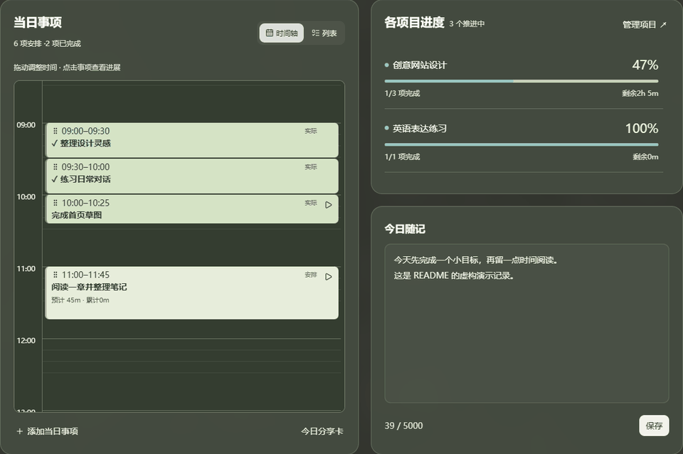
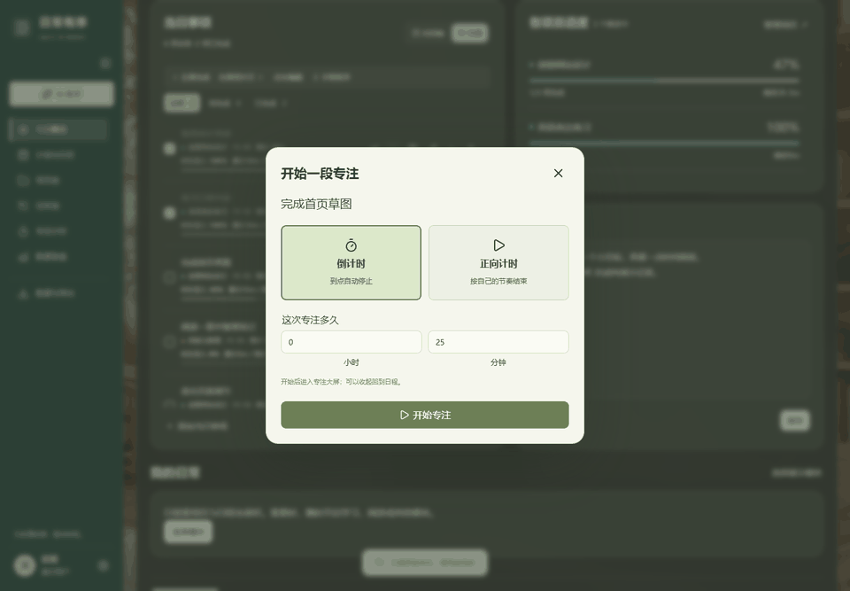
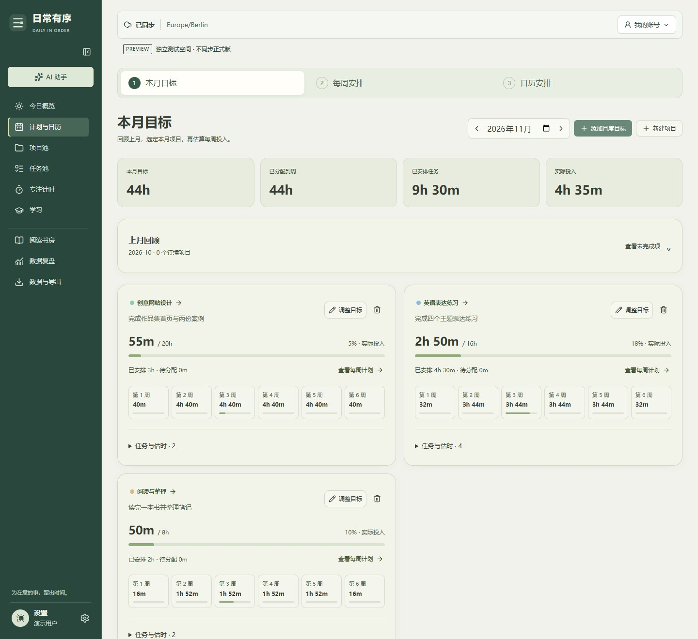
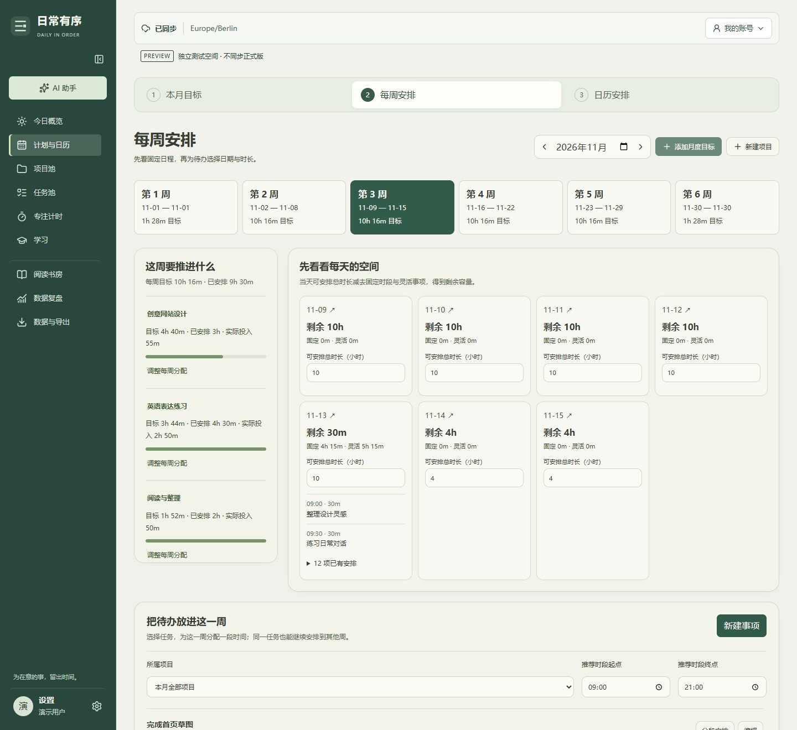
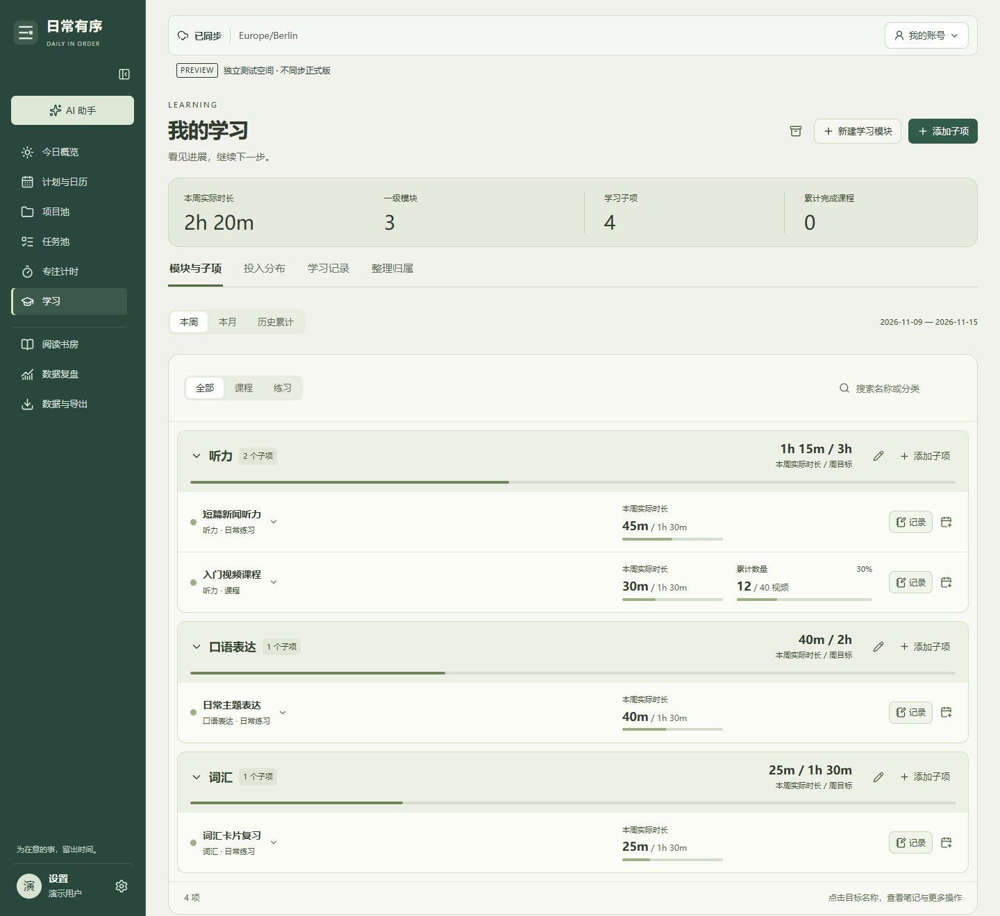
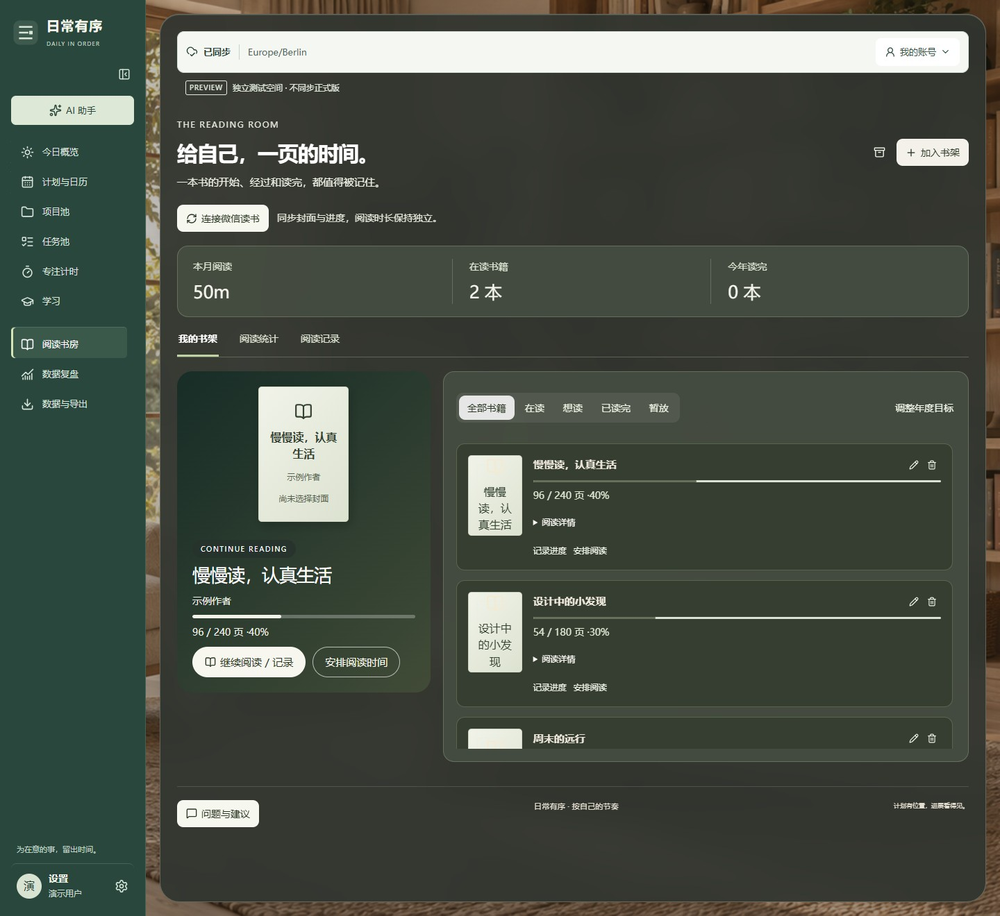

<div align="center">


# 日常有序 · Daily in Order

**把目标安排进日常，让每一段投入都有迹可循。**

一个从个人需求出发、持续迭代的 AI 辅助规划与投入记录工作台。

[在线体验](https://personal-daily-organize.web.app/?lang=zh) · [English](README.en.md) · [反馈与建议](https://github.com/Kylie08ky/daily-in-order/issues)

React · TypeScript · Firebase · PWA

</div>

<table>
<tr>
<td width="50%" valign="top">
<strong>今日概览</strong><br />
<a href="docs/images/today-demo-zh.jpg"></a>
<br />今天的安排、项目进度与随记。
</td>
<td width="50%" valign="top">
<strong>当日时间轴</strong><br />
<a href="docs/images/timeline-demo-zh.jpg"></a>
<br />实际投入与未来安排，在同一时间轴查看。
</td>
</tr>
</table>

> 当前正式版 **v0.24.2**，优先支持电脑端。在线体验需注册并验证邮箱；手机端会提示建议使用电脑，也可以选择继续使用。
>
> 本页 8 组截图于 2026-11-13 使用 v0.24.2 本地应用重新拍摄，仅含虚构测试数据。图片中的 PREVIEW 标识来自隔离测试环境，点击图片可查看大图，详见[截图说明](docs/images/README.md)。

## 为什么做这个项目

计划通常分散在日历、待办清单、学习笔记和阅读记录里。一个任务从“这个月想做”到“今天实际做了多久”，需要在不同地方反复填写；计划变化后，过去的投入也容易失去关联。

日常有序把这条过程放进同一个工作台：

**月度目标 → 每周分配 → 每日安排 → 专注投入 → 记录进度 → 回顾调整**

它最初用于解决我自己的日常规划问题，随后逐步加入独立账号、可选模块和多语言，成为其他人也能按自己的习惯使用的工具。

## 看看实际操作

两段短动图展示真实界面操作，使用本地虚构数据。点击可放大；下方保留静态截图，方便查看细节。

<table>
<tr>
<td width="50%" valign="top">
<strong>调整任务安排</strong><br />
<a href="docs/images/schedule-motion-zh.gif"></a>
<br />列表与时间轴切换 → 拖动开始时间 → 调整预计时长。
</td>
<td width="50%" valign="top">
<strong>进入专注</strong><br />
<a href="docs/images/focus-motion-zh.gif"></a>
<br />选择正向计时 → 开始专注 → 暂停与继续，成长值随真实计时变化。
</td>
</tr>
</table>

## 三个核心体验

### 01 / 从一句话开始，把想法变成可执行的安排

在 AI 助手中描述目标，再核对和修改草稿，确认后创建项目、任务与时间安排。新用户可以通过对话入门，已有用户也能随时重新打开引导。

例如，可以这样描述自己的计划：

> “这个月想学完一门课程，预计需要 12 小时。先分到每周，周末多安排一点，具体开始时间暂时不定。”

助手支持月周规划、常驻任务、学习子项与跨日分段；也可以选择原任务，重新估算剩余工作量。它生成的是待确认的计划，不代替用户填写真实投入或完成数量。也保留普通清单录入。

### 02 / 一个任务，多天推进

一个预计 6 小时的任务，可以本周安排 2 小时、下周安排 4 小时，所有投入仍汇总到原任务。

- **灵活安排**：可以只选日期和时长，开始时间非必填。
- **时间轴与列表切换**：有明确钟点的安排可以拖动调整。
- **重新估算剩余工作**：已经做了多久、还需要多久、剩余已安排多少，分别展示。
- **保留实际历史**：调整未来计划不移动已经发生的投入；用时超过预计也不会自动完成任务。

### 03 / 做完一段，时间与成果一起留下

从今日事项直接开始正向或倒计时，进入全屏专注。结束后记录实际投入，并按关联对象补充视频数量、阅读页码或项目成果。

**同一次活动只记录一次时间。** 今日事项、学习子项、阅读书房和项目进度通过原记录关联，补填成果不再增加一份用时。

<table>
<tr>
<td width="50%" valign="top">
<strong>AI 助手</strong><br />
<a href="docs/images/quick-start-zh.jpg"></a>
<br />描述计划，核对草稿后再保存。
</td>
<td width="50%" valign="top">
<strong>全屏专注</strong><br />
<a href="docs/images/focus-demo-zh.jpg"></a>
<br />计时与虚拟激励并排展示。
</td>
</tr>
</table>

截图展示当前助手入口；本地模拟器关闭云端 AI，未发送对话或伪造生成结果。

“潜在财富”随专注时间增长，是虚拟激励，不代表真实收入。

## 按需组成自己的工作台

核心是日程与项目，其余模块由用户选择开启。

| 模块 | 能做什么 |
| --- | --- |
| 月度与每周规划 | 制定月目标，按当月各周天数初步分配时长，再结合固定安排调整 |
| 项目与任务池 | 管理长期常驻、阶段性常驻和一次性任务；同一任务跨日执行 |
| 学习 | 一级模块与子项，时长和数量分别记录；切换本周、本月、历史累计并追溯来源 |
| 阅读 | 真实书封面、当前阅读位置与当次页码，保留每次阅读的历史进度 |
| 作息与健身 | 习惯、睡眠和运动记录；按需开启每日摄入与营养目标 |
| 财务与预算 | 自定义账户、预算和币种，不同币种分别统计 |
| 数据复盘 | 查看投入趋势、项目进度和专注历史；从来源纠正时长或归属 |
| 备份与交换 | JSON 备份与恢复、任务 CSV、日历 ICS 导入导出 |

<table>
<tr>
<td width="50%" valign="top">
<strong>月度目标</strong><br />
<a href="docs/images/monthly-demo-zh.jpg"></a>
<br />按项目设定月度投入，再分配到各周。
</td>
<td width="50%" valign="top">
<strong>每周安排</strong><br />
<a href="docs/images/weekly-demo-zh.jpg"></a>
<br />结合每天的固定安排与可用时间继续拆解。
</td>
</tr>
</table>

<table>
<tr>
<td width="50%" valign="top">
<strong>学习模块与子项</strong><br />
<a href="docs/images/learning-demo-zh.jpg"></a>
<br />周目标、实际时长与课程数量分别展示。
</td>
<td width="50%" valign="top">
<strong>阅读书房</strong><br />
<a href="docs/images/reading-demo-zh.jpg"></a>
<br />书架、当前页码与本月阅读投入。
</td>
</tr>
</table>

阅读截图使用虚构书籍与默认封面占位；未连接真实微信读书账号。

界面支持 **中文 / English / Deutsch**，用户填写的任务与笔记不会被自动翻译。

## 实现中重点解决的问题

这个项目的重点，也在于多个入口如何共用同一份记录，以及持续迭代时如何保留历史。

| 设计问题 | 实现思路 |
| --- | --- |
| 多个模块重复计算同一次投入 | 使用稳定 ID 关联原任务、投入与成果，共用统计逻辑 |
| 计划变化影响实际历史 | 区分预计、剩余计划、执行分段与真实投入，修改计划保留实际日期和时长 |
| 离线修改与云端同步 | IndexedDB 本地队列、同步重试与冲突处理；保留未同步操作 |
| 测试数据进入正式账号空间 | 预览与正式共享登录身份，但工作台、反馈及离线队列分别存储 |
| AI 草稿直接污染真实记录 | 结构校验、用户核对后保存；复用原领域操作，不由 AI 编造实际投入 |
| 发布过程难以追踪 | 先预览、后确认，原样提升已审阅的 Hosting 版本；正式足迹按发布批次汇总 |

**技术栈**

- **界面**：React 19、TypeScript、Vite、Lucide。
- **账号与存储**：Firebase Authentication、Cloud Firestore 与安全规则。
- **AI**：Firebase AI Logic、Gemini、App Check；云端能力可选配置。
- **离线与安装**：Service Worker、IndexedDB、PWA。
- **验证**：Node.js 测试、Firebase 本地模拟器与规则测试、构建检查。

可从 [app](app)、[lib](lib) 与 [tests](tests) 查看实现和测试。发布约定见[维护说明](docs/MAINTENANCE.md)。

## 本地体验

需要 **Node.js 24.12+、npm、Java 21+**。默认使用本地账号与数据库模拟器，不需要连接真实用户数据。

```bash
git clone https://github.com/Kylie08ky/daily-in-order.git
cd daily-in-order
npm ci
npm run emulators
```

另开一个终端：

```bash
npm run dev
```

打开 <http://127.0.0.1:52700>，注册虚构测试账号；邮箱验证链接会出现在模拟器终端。模拟器数据默认不跨重启保留。

```bash
npm test
npm run test:rules
npm run build
```

[完整运行与部署指南](docs/SETUP.md) · [维护与发布流程](docs/MAINTENANCE.md) · [微信读书连接说明](docs/WEREAD.md)

## 当前边界

- **电脑端优先**：手机布局仍在迭代，暂不作为主要支持目标。
- **离线有范围**：首次加载与登录需要联网；已缓存内容可离线使用，恢复联网且应用打开后同步。应用关闭后没有云端定时任务。
- **AI 需要核对**：联网、安全验证和服务额度会影响可用性；生成建议不保证没有日程冲突，始终保留手动录入。
- **微信读书仍限预览环境**：当前正式服务尚未开放连接；只读同步封面与阅读进度，不合并阅读时长。
- **备份需谨慎恢复**：完整恢复会替换当前工作台，应先备份。公开仓库不包含用户记录、个人导出或服务端凭证。

## 关于项目

由 [Kylie](https://github.com/Kylie08ky) 从实际使用出发设计和迭代，持续根据反馈调整。

欢迎通过应用内反馈或 [GitHub Issues](https://github.com/Kylie08ky/daily-in-order/issues) 提交使用场景、问题和建议。描述问题时请移除个人资料。

仓库目前尚未选定开源许可证；公开源码不等于授予任意再分发或商用许可。第三方依赖及素材遵循各自许可。
