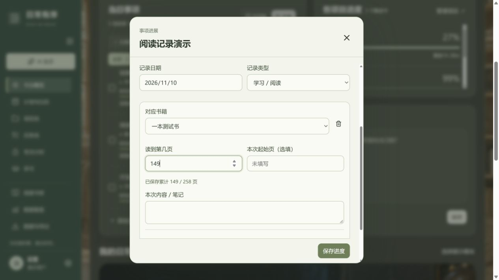
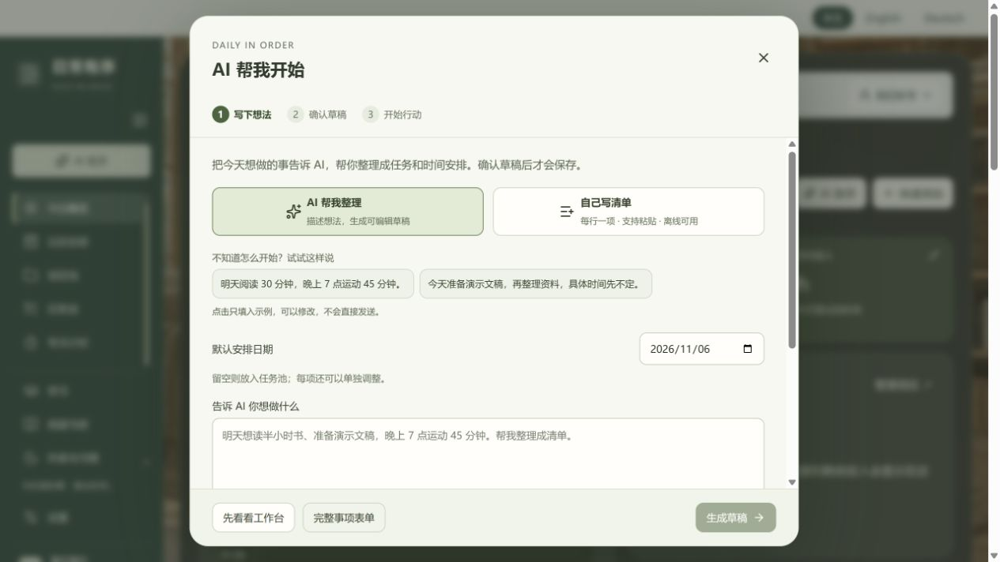
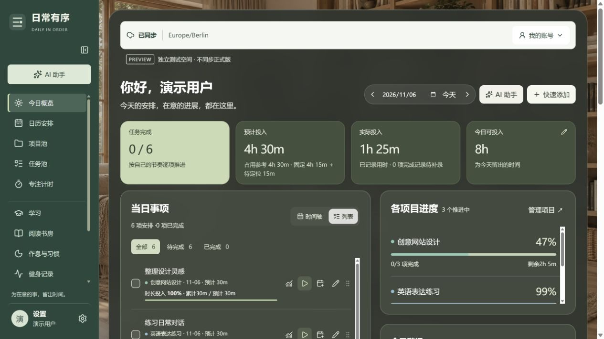
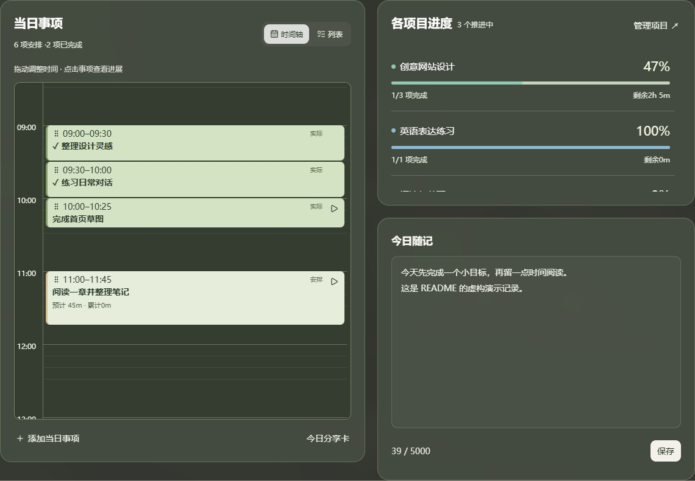
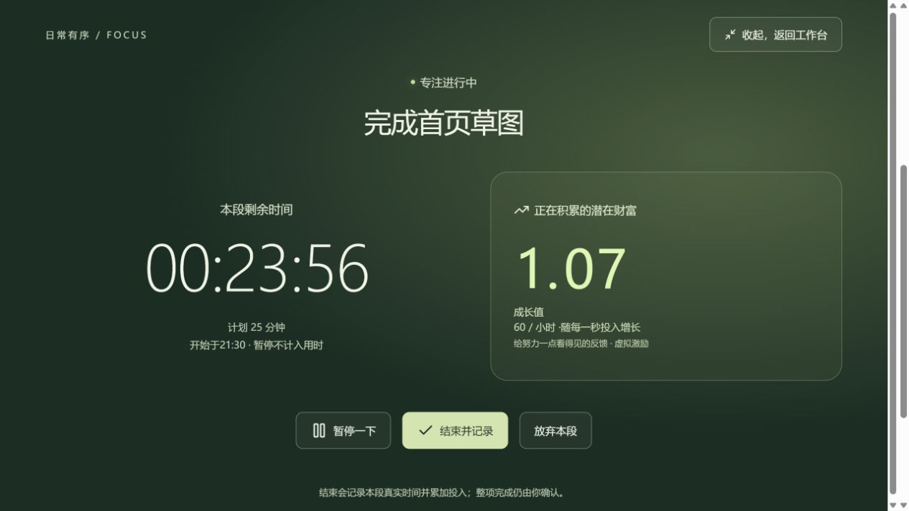

# 日常有序 · Daily in Order


**v0.23.4 预览：** 编辑事项与时间安排统一字体、正文字号和行高，说明文字保持清晰对比，标题保留层级。


**v0.23.3 预览：编辑事项内调整安排。** 已拆分任务直接展示未做分段的日期、起止时间或「灵活时间」；点击「调整时间安排」在同一窗口修改，开始时间仍可留空。安排单独保存，返回编辑时保留标题、备注草稿；关闭未保存的安排会先确认。原实际投入、专注和发生日期保持不变。

把目标安排进日常，把每一段投入记录下来。

**简体中文** · [English](README.en.md)

[在线使用](https://personal-daily-organize.web.app/) · [功能与使用](#功能与使用) · [本地运行](#本地运行) · [部署自己的版本](#部署自己的版本)

日常有序是一个支持中文、英语和德语的个人工作台：在同一个地方安排任务、记录专注、查看项目进度，也可以按需开启学习、阅读、作息、健身和财务模块。采用绿色主色、卡片式布局，适配电脑与手机。

本仓库包含应用源码、测试和部署脚本，不包含作者或其他用户的工作台记录、备份、账号凭证或生产环境配置。在线服务需要注册自己的账号；自行部署时请使用自己的 Firebase 项目。

**当前正式版：v0.22.0（2026-11-13）**。已将负责人确认的预览 Hosting 版本原样发布，七次预览更新合并为本次的一条正式版本足迹，正式页面不显示预览修改明细或待发布列表。包含今日进度记录、具体项目成果与历史页码、学习时长来源、真实封面、微信读书界面、剩余工作重新估算及独立发布记录。预览与正式用户数据继续隔离。微信读书中转服务仍仅允许预览来源，正式域名接入待负责人确认，正式版连接暂不可用。

以下 v0.16–v0.22 为开发时的预览说明，现已合并发布；涉及微信读书服务的限制以顶部正式发布说明为准。

**v0.22.0 预览：分开记录版本足迹。** 设置 → 关于中，预览版保留逐次修改明细，并可查看正式发布记录与待发布批次；正式版仅显示已确认发布的汇总。正式发布脚本锁定已审阅的 Hosting 版本，发布成功后以实际发布日期写入一条公共更新记录，重试不会重复添加。用户工作台与测试数据不参与发布。

**v0.21.0 预览：进行中任务重新估算。** 在「分段安排 → 调整剩余计划」填写从现在到完成所需的全部时间，然后跨日、跨周分配；开始钟点可留空。已投入、剩余计划、已安排剩余、待分配、当前总预计和初始预计分别展示。保存原子替换未做安排，保留原任务与投入 ID、日期、专注和成果；后续实际投入按差额扣减剩余。超额分配阻止保存，旧分段有歧义时要求核对；估算用满不会自动完成任务。支持原有推荐时段，使用 schema 16 共用前端与云同步编解码，预览数据不进入正式版。

**v0.20.0 预览：连接微信读书。** 阅读书房增加连接、选择电子书和确认旧书关联的流程，同步真实封面与独立的阅读百分比。按书籍 ID 去重；不换算纸质页码、不导入阅读时长、不新增任务或投入。个人密钥只用于本次窗口连接，不保存到工作台。**负责人预览环境的 Cloudflare Worker 已部署并接入，连接入口已启用；正式版未更新。** 已通过 HTTPS、预览来源、登录拒绝检查，并用虚构密钥验证已登录请求能到达微信读书；真实书架、封面与进度仍需用户在界面输入自己的微信读书密钥验证。自行部署时需配置自己的 Worker。[部署与数据边界](docs/WEREAD.md)。

**v0.19.0 预览：真实书籍封面。** 所有用户都可在加入或编辑书籍时搜索书名、作者、ISBN，确认后选择封面；未收录的版本支持上传或图片链接。书架与首页共用真实封面，不改动阅读记录。

**v0.18.0 预览：可追溯的学习时长。** 展开学习子项 →「统计关联 / 时长来源」，按本周、本月或历史累计查看原任务、实际日期、完成状态、本期贡献与任务累计；有投入但未完成的任务单独列出并计入。跨周投入按原分段日期统计，任务、专注和学习入口不重复计时。

来源行可打开原记录、修正具体投入段、追加一次投入或预览整条任务的归属变更。未分段的旧用时明确标出沿用的任务日期；缺失来源单独列为待核对，不推算日期。修正使用差额，不新增用时；已有分段时，累计修正只能明确调整剩余用时，不能覆盖原分段。保存冲突时保留输入，修改历史支持撤销。仅改归属保留数量、页码、日期、完成状态及专注秒数，不影响模板或其他日期任务。

**v0.17.0 预览：具体开发项目与真实历史页码。** 在顶层项目下新增具体项目，可关联常驻入口，以稳定 ID 保存名称及进行中／暂停／结束状态。一次投入可为多个具体项目记录成果；详情按日期显示并编辑原记录，未分配用时显示“共享投入”，不复制时长。旧成果保留“待关联”，改名或结束项目不删除历史。

阅读历史只显示当次记录自己的页码；缺失显示“当次页码未填写”，不使用书籍当前进度兜底。历史行的“修改当次页码”只更新页码字段，保留原日期、用时、专注和完成记录。较早记录的补录不覆盖较新页码；仅明确起止页时计算本次阅读页数。

**同步格式兼容与数据保护。** 工作台读写共用支持 schemaVersion 1–16 的解析器；Firestore 分块封装仍为版本 1，与工作台数据版本不同。遇到不支持的格式会停止解析及上传并提示更新，保留现有云端内容和本机待同步队列，不降级、不清空、不恢复旧备份。`/version.json` 提供应用版本、同步版本、支持的数据格式、入口脚本和 SHA-256，方便核对部署；页面与同步适配器来自同一构建。正式版为 v0.22.0（数据格式 16），预览发布不会变更正式版或搬运数据。

**v0.16.0 预览：今日事项直接记录进度。** 在事项旁点击进度图标，或结束一段专注后，直接补充学习数量、当前阅读页码与多个项目的版本成果。模块里的关联记录也打开同一编辑入口，新增记录可先按实际日期选择已有任务。每次保存替换同一记录，不新增任务或时间；“修正已有用时”与“追加一次投入”分开操作。

- 视频按本次增量记录；编辑 2→3 只净增 1，复看不加完成数，提供相同视频编号时去重。未提供编号时不猜测内容身份，旧的课程基准数量保持原样。
- 阅读按当前页码记录，早日期补录不覆盖较晚进度；只有填了起止页才计算本次页数。一次读多本书可分别分配分钟，不能超过原投入。学习可以标注多个方向，或明确分配各子项分钟（总和须等于该段实际用时）。
- 一个开发任务可记录多个项目的版本、状态、成果和下一步。项目页可查看并编辑原成果，时间仍只保留在原任务中，阶段完成不会完成整个项目。
- 历史记录可原地补充与修改，日期、专注秒数和原任务 ID 保留；从新进度入口移除 / 恢复进度不删除时间。没有数量或页码的记录显示“未填写”。关联以用户选择为准，不按相似标题自动合并。
- 使用 schema 13 保存用时修正历史、具体项目 ID 及投入进度；兼容读取 1–12。预览和正式数据继续隔离；本次尚未发布正式版。



<details>
<summary>历史开发记录（以下预览状态为当时状态，功能现已随 v0.15.0 发布）</summary>

**v0.8.2 已发布：** 语言切换移到设置页标题旁，支持中文、English、Deutsch，并记住当前设备上的选择；工作台顶部不再显示语言栏。侧栏目录独立滚动，底部「头像、名称、设置」合并为一个入口。已于 2026-11-06 经预览确认后原样发布到正式版，未复制预览数据。

**v0.8.3 预览：** 项目详情的「模块 / 任务」默认收起各模块，保留完成数量与进度条。点击模块标题展开或收起，也可全部展开 / 收起；添加事项会自动展开对应模块。切换看板或页面后，本次打开工作台期间的展开状态会保留。正式版仍为 v0.8.2。

**v0.8.4 预览：** 每个项目可选择「按投入时长」或「按任务完成度」，项目总进度、首页及模块进度条使用同一选择，并随账号保存。时长进度为有预计用时任务的累计实际用时 ÷ 预计用时，上限 100%；没有预计用时的任务不参与该比例，全部未设时会提示补充。任务完成度沿用各项完成百分比的平均值。切换不改任务、记录或统计时长；旧项目默认沿用任务完成度。正式版仍为 v0.8.2。

**v0.8.5 预览：** 项目详情顶部操作改为紧凑的横向按钮，图标与文字保持一行；长项目名或窄窗口下，操作组整体换到标题下方，不再把按钮挤成竖排。正式版仍为 v0.8.2。

**v0.8.6 预览：** 模块标题旁新增上移 / 下移按钮，可调整包括「未分模块」在内的显示顺序，电脑和手机均可操作。顺序随项目保存，刷新后保留；不会移动或改写模块里的任务。正式版仍为 v0.8.2。

**v0.9.0 预览：** 新增「月度目标」：选择本月项目、填写目标时长及可选成果，按各周在当月的天数自动分配整分钟，也可逐周调整、保存未分配余额。月度计划与每周执行分开展示目标、已安排任务时长和实际投入；本周可直接安排已有未排期任务、修改本周任务或新建事项，并进入周日历。实际用时复用专注 / 补记记录，修改、删除记录后自动回算，不重复创建任务；跨月周仅统计当月天数。已有月份固定其周起始日，修改全局偏好不改变历史分配。正式版仍为 v0.8.2。

**v0.14.1 预览：** 日历侧栏任务池重新排版：顶部保留紧凑的项目 / 模块筛选，长期、阶段、一次性三类直接切换并显示数量。任务行统一标题、归属和时长的层级；右侧小加号为加入今天，日历图标为选择日期，省略号编辑入口，均有悬停说明。标题与筛选固定，列表内部滚动；窄屏保留相同操作。仅调整界面，不修改任务分类、记录或统计。

**v0.15.0 预览：** 今日概览的列表支持左滑完成、右滑移到次日、点击文字编辑和手柄排序。滑动松手达到阈值才执行，纵向仍可滚动；也可用完成 / 次日按钮及手柄方向键操作。完成沿用实际用时与阅读页码表单。顺延只移动所选日的安排，保留原任务、实际投入日期、专注记录与进度；已完成或正在专注的任务不顺延。正式版仍为 v0.8.2。

**v0.14.0 预览：** 任务池支持长期常驻、阶段性常驻与一次性任务。原有模板直接复用，日历侧栏按三类展示并可按项目、模块筛选；「常驻任务模板」仅列长期常驻。新建 / 编辑事项选择任务类型，或编辑入口的分类；长期与阶段性入口可加入今天、选择日期或拖到日历，确认本次时长，钟点可留空。每次执行生成独立任务并保留项目、模块、学习子项关联；同一入口同一天已有任务（含已完成）时提供查看 / 继续，不重复创建。支持暂停、恢复、归档，原任务与投入记录不随入口改变。未使用的入口不计入预计用时、待办或逾期；转换从未开始且无日期的占位任务时，保留原 ID 和内容作为入口来源，停止将它计入待办。已有执行、专注、课程数量不会被复制或补记；现有自动重复规则也不会被停用或改写。未分类的旧模板中，Hugging Face、Neo4j、AVF K2/K3 和 Valeo 讲座默认显示为阶段性，其余默认长期，可手动改分类；普通历史任务不按标题自动批量迁移。数据格式为 v10，旧页面需刷新；仅预览版更新。

**v0.13.0 预览：** 一个任务可分多天、跨周安排，例如总预计 6 小时，本周 2 小时、下周 4 小时，始终保留同一个任务 ID。从任务旁的日历图标、事项进展的「分段安排」或每周安排进入；已有整段安排先点「调整」缩短，再添加下一段。开始时间可留空，界面显示总预计、已分配和待分配；每段可以独立改期、拖动、调整时长或移除。日历和月/周已安排时长只计算对应日期的分段，实际投入仍由原任务的专注/补记汇总，安排不会自动产生实际用时。计时结束只替换所关联的安排，未来分段仍保留；移除安排不会删除实际记录。完整 JSON 备份保留分段关系，ICS 导出每段日程（ICS 重导入不用于恢复任务关系）；每段不跨午夜。包含/并行关联任务需先解除关联；重复事项只拆分所选的一次。预览数据格式升级为 v9，旧 v8 客户端应刷新后使用，不回退写入；正式空间不变。

**v0.12.0 预览：** 侧栏的月度目标与日历合并为「计划与日历」：本月目标 → 每周安排 → 日历安排。先回顾上月未完成项目 / 事项，选择纳入本月并调整预算，再按当月各周天数自动分配、手动修订。项目卡可核对任务估时；每周页面同时展示项目预算、每天固定日程、灵活事项和剩余容量。可设置推荐时段范围，推荐避开固定时段、任务截止日与容量不足的日期；确认后才保存，开始时间也可留空。每日容量表示可安排的总时长（含固定事项），剩余容量扣除固定时段并集与灵活估时。任务通过「分段安排」拆到不同日期，单段时长与整项总预计分开保存。正式版与个人数据均未改动。

**v0.11.0 预览：** 学习页新增「整理归属」：按项目、原标题、实际日期和当前子项筛选原任务 / 学习记录，勾选后预览归属、实际时长及模块和子项变化，再原子提交。任务详情与学习记录编辑页可单独保存所属子项；常驻模板与重复规则也可重新关联（规则仅同步尚未开始的已有事项）。迁移保留原 ID、日期、分钟、专注秒数、完成状态、备注与课程数量，数量进度留在原课程；时长按任务去重，不计预计时长。保留迁移历史、撤销和未明确关联筛选，隐藏历史汇总前检查剩余关联。预览过期或归属被再次修改会要求重新核对，不覆盖较新操作。仅预览版，未自动迁移任何用户数据。 采用数据格式 v8 保存归属与撤销历史；旧数据可读取升级，其他仍打开的旧页面需刷新后再编辑。

**v0.10.1 预览：** 学习模块改为紧凑对齐的行布局：名称、时长、累计数量及操作独立成列，数值与说明相邻，记录按钮缩小；手机上名称与操作同排，进度放在下一排。统计与已有记录不变。

**v0.10.0 预览：** 学习页按自定义一级模块组织课程 / 练习子项，模块可折叠、改名并设置周时长目标。子项可分别设置每周 / 累计时长目标和数量总目标；本周、本月、历史累计切换只改变时长统计，课程数量始终标注为累计。记录、专注与补记用时自动汇总，不重复计时；旧分类、任务关联及数量记录保留，不按标题猜测拆分历史记录。正式版暂未更新。

**v0.9.1 预览：** 阅读书房按「读到第几页」记录，不再需要手算本次页数。完成已关联书籍的每日任务时也可直接填写页码，复用原任务和用时；留空可稍后补记。历史增量记录保持兼容，编辑、删除或恢复记录会重新计算书籍进度。正式版暂未更新。

学习、阅读和训练记录会按所选日期筛选可关联任务；更换日期会清空尚未保存的任务选择。编辑已有记录保留原任务关联。


</details>

## 界面预览

以下六张截图直接展示，无需展开。全部来自空白登录页或本地虚构测试账号，不含真实用户记录。[截图说明](docs/images/README.md)

### 快速开始（v0.8.0）

首次进入直接看到 AI 入门，也能手动录入或跳过。下面使用本地虚构账号展示界面，未发起云端 AI 请求。



### 今日概览

待办清单、项目进度和今日随记。v0.8.2 演示截图展示去掉顶部语言栏后的工作台、独立目录滚动与底部设置入口；使用虚构账号，生活模块已开启。



### 当日时间轴

连续的实际投入记录与后续安排，在同一条时间轴中显示。



### 沉浸专注

当前任务、倒计时与实时增长的虚拟激励。



### 登录界面


### 每日摄入

营养数字仅用于界面演示，不是饮食建议。


## 功能与使用

| 模块 | 可以做什么 |
| --- | --- |
| 今日与日历 | 在列表和时间轴之间切换，拖动调整时间；没有固定开始时间的事项也能保存 |
| 项目与任务池 | 创建项目、拆分任务、设置重复安排，查看任务及项目进度 |
| 专注与投入记录 | 正向计时或倒计时，记录实际开始和结束；分段累积投入，修改或删除单段记录后重新计算统计 |
| 学习与阅读 | 自定义学习方向、练习和目标；查看投入进度，记录书籍页数、阅读时长及起止日期 |
| 作息、运动与摄入 | 习惯打卡、睡眠和训练记录；可选每餐热量、蛋白质及运动消耗记录 |
| 财务与预算 | 自定义账户和预算；不同币种分别统计，不自动换算汇率 |
| 数据复盘与备份 | 查看投入趋势；完整 JSON 备份与恢复、任务 CSV、日历 ICS 导入导出 |
| 新手引导与反馈 | 选择需要的模块、设置目标、逐步学习操作；提交反馈并查看处理情况 |

**v0.23.2 预览：专注记录按月归档。** 默认仅显示工作台当前月份，历史月份通过下拉框查看，并可一键回到本月；月内保留按日折叠、每日明细滚动及每页七个日期。月份汇总仅统计选中月份。归档只是查看方式，不迁移或删除记录，不改变累计统计。

**v0.23.0 预览：对话规划 → 核对草稿 → 一次确认保存。** 新用户注册并验证邮箱后看到「AI 帮我开始」；老用户从侧栏 AI 助手或设置 → 使用指南重新打开。支持项目、月度目标（默认按当月各周天数分配，可编辑每周分钟数）、长期／阶段性常驻入口、学习模块周目标和子项数量目标、同一任务跨日分段。日期可空，具体开始时间始终可空：有日期无钟点的任务是灵活事项。常驻不等于自动重复，仅为明确选择的日期创建当次任务。

要重新估算进行中任务，先在 AI 入口的可选区域选择**原任务**。草稿展示原剩余、新剩余、被替换的未做分段与待分配量；新剩余是全部剩余的替换值。确认保存复用现有领域操作，整批成功或整批失败；重复提交幂等，检测到原计划被修改则拒绝旧草稿。保留原任务、历史日期、实际用时、专注与成果；AI 不写实际投入、完成状态或已看视频数量。同名进行中项目、精确学习路径和可用常驻入口在本机复用，不自动合并相似名称或覆盖已有课程进度。高级规划保存后可在原模块继续修改；整批撤销仍仅用于手动清单新建项目与任务。

**数据发送由用户选择。** 默认仅发送本次输入、最近六条对话及草稿。选中原任务后，额外发送其标题、已投入、剩余预计和未做分段；勾选参考月份后，发送该月无标题的占用时段（最多500段）、可用时间和月目标摘要。不发送历史学习明细、笔记、成果或财务。云端草稿必须经用户核对，AI 不自动保存；日程建议并非无冲突保证。手动清单离线可用，AI 需要联网。新手指引同步解释月周规划、三类任务、学习子项、分段和调整剩余，不再强制填写钟点。此功能先发布预览，正式版需另行确认。

云端 AI 还需要 Google App Check 验证通过。若浏览器出现验证失败（例如 403），输入会保留，可改用普通清单；应用不会跳过验证，也不会自动改用收费接口。

AI 试用设有**本设备每账号每天 10 次尝试（UTC）**的浏览器计数，包括失败请求；这不是服务端账号配额，也不是防滥用或费用上限，清空存储/换设备会重置。服务商免费配额另有限制。零付费试用依赖 Firebase **Spark、未关联 Cloud Billing**；额度耗尽时停止调用，不自动升级。

自行启用：按 [Firebase AI Logic 文档](https://firebase.google.com/docs/ai-logic/get-started?platform=web) 配置 Gemini Developer API 和 App Check，在 `.env.local` 填写 `.env.example` 中的三个 AI 配置项。App Check 站点密钥只允许自己明确审阅的预览与正式域名，不启用“允许所有域名”；首次正式发布前核对正式域名已加入允许列表。不要放入 Gemini 密钥，不要为本功能启用 Cloud Functions 或绑定结算账户。App Check 策略为项目级，勿未经审核改变正式环境的校验策略。查看 [免费方案条件](https://firebase.google.com/docs/ai-logic/pricing) 和 [Google AI 数据使用条款](https://ai.google.dev/gemini-api/terms)。本地模拟器始终关闭真实 AI 请求，测试只使用虚构返回。

默认使用支持免费调用的 `gemini-3.5-flash-lite` 处理任务草稿，可通过 `VITE_AI_MODEL` 配置。

发布前运行 `npm run check:ai`：只读检查 Firebase App Check、reCAPTCHA Enterprise、Firebase AI Logic、Generative Language 四个 API 已启用，站点密钥已填写，且未关联 Cloud Billing；预览发布脚本也会执行此检查。配置了 reCAPTCHA 密钥并不代表 App Check API 已启用。新启用 API 后，等待服务权限生效，再刷新页面重试。检查通过仍须在浏览器实际生成草稿验收。验证失败、服务配置错误、额度耗尽、网络或服务端异常及无效草稿会给出不同提示，不展示服务商原始响应。

语言可在界面切换，也可通过 `?lang=zh`、`?lang=en`、`?lang=de` 指定。用户自己填写的任务、笔记和书名不会被自动翻译；CSV 目前使用中文列名。

专注中的“潜在财富”是随时间增加的虚拟激励数值，不代表真实收入。营养目标是参考估算，支持用户调整，不用于医疗诊断或治疗。

## 技术栈

React 19 · TypeScript · Vite · Firebase Authentication · Cloud Firestore · Firebase Hosting · IndexedDB · Service Worker

业务逻辑集中在 `lib/`，界面在 `app/`，数据通过账号专属的本地操作队列与云端同步。Firestore 规则要求已验证邮箱，并按 UID 限制工作台读写。

## 本地运行

需要 **Node.js 24.12+、npm、Java 21+**。Java 用于 Firebase 模拟器。首次安装依赖和下载模拟器需要联网。

```bash
git clone https://github.com/Kylie08ky/daily-in-order.git
cd daily-in-order
npm ci
```

终端一，启动本地账号与数据库模拟器：

```bash
npm run emulators
```

终端二，启动网页：

```bash
npm run dev
```

打开 <http://127.0.0.1:52700>。开发模式默认连接本地模拟器，不需要真实 Firebase 项目。模拟器使用 `demo-friends-isolation` 项目标识；注册后，验证邮件链接会出现在模拟器终端中，不会发送真实邮件。

模拟器数据默认不会在重启后保留，重要测试记录请先从应用导出备份。

## 部署自己的版本

1. 创建自己的 Firebase 项目和 Web 应用，启用 Authentication 的**电子邮件地址 / 密码**登录方式，并创建 Firestore 数据库。
2. 复制 `.env.example` 为 `.env.local`，填入该 Web 应用的 Firebase 配置。复制 `.firebaserc.example` 为 `.firebaserc`，将 `projects.default` 改为相同的项目 ID。这两个实际配置文件已被 Git 忽略。
3. 在 Authentication 的授权域名中检查你的正式站点与预览站点域名。注册后需要完成邮箱验证才能访问个人云端数据。
4. 登录 Firebase CLI，运行检查，再部署预览。

```bash
npx firebase login
npm test
npm run test:rules
npm run build
npm run deploy:preview
```

环境变量中的 `VITE_` 配置会包含在浏览器代码中，只能填写公开的 Web 客户端配置。**不要填写服务账号私钥、管理员令牌或其他服务端凭证。** 访问控制依赖 Authentication 和 Firestore 规则，而不是隐藏 Web API key。

`npm run deploy:preview` 会构建应用、部署 Firestore 规则和索引，并创建 / 更新有效期 30 天的 `workbench-review` Hosting 预览频道。**数据库规则和索引是项目级设置，修改它们也会影响正式环境。** 有效期到期后可重新部署预览。

确认预览后，将同一份已检查的构建发布到正式站点：

```bash
npm run release:friends -- --confirm-reviewed-preview
```

该命令只提升 Hosting 版本，不重新构建，也不复制工作台数据。脚本要求 `.env.local` 中的项目 ID 与 `.firebaserc` 一致；默认使用项目同名的 Hosting 站点。

如需自定义正式域名，将域名加入 `VITE_LIVE_HOSTS`，以英文逗号分隔，只填主机名，并重新构建。未知域名会拒绝连接数据空间。

如确实需要让本地开发连接自己的云端项目，填写配置后设置 `VITE_FIREBASE_EMULATORS=false`；本地主机仍使用预览数据空间。

### 预览与正式数据

| 内容 | 正式版 | 预览版 |
| --- | --- | --- |
| 工作台记录 | `users/{uid}` | `previewUsers/{uid}` |
| 反馈 | `feedback` | `previewFeedback` |
| 本地离线队列 | 正式命名空间 | 独立预览命名空间 |
| 注册与登录身份 | 同一 Firebase Authentication 项目 | 同左 |

两边可以使用同一个账号登录，但任务与测试记录分别保存。发布功能不会把预览数据带到正式版。预览版首次初始化会开启附加模块，便于检查；正式版由新用户在引导中自行选择。

如需查看所有用户反馈，在 Firebase 控制台为管理员 UID 创建 `feedbackAdmins/{uid}` 文档，设置布尔字段 `enabled: true`。管理员仍需验证邮箱；客户端不能自行授予该权限。

## 离线与数据说明

- 首次加载、注册和登录需要网络。已缓存的页面和已加载的记录可在离线时继续使用，修改在应用打开并恢复联网后同步。
- iPhone 可通过 Safari 的“分享 → 添加到主屏幕”安装；桌面端可使用支持 PWA 的浏览器安装。
- 应用完全关闭后没有云端定时任务。重复安排等更新在打开应用时处理。
- 浏览器清理站点数据、系统回收存储或设备丢失可能影响未同步记录，建议定期导出 JSON 备份。
- 完整恢复会替换当前工作台记录；请先备份。CSV 和 ICS 用于交换数据，不能代替完整备份；ICS 仅支持实现中的常见重复规则。
- 当前为持续迭代的个人项目；测试范围以仓库中的测试为准，部署前请检查依赖和自己的环境配置。

## 维护与发布流程

后续功能修改按以下固定流程进行，不需要额外提醒同步 GitHub：

1. **修改并验证**：完成相关代码与检查，保护现有用户记录以及预览 / 正式数据隔离。
2. **同步 GitHub 与中英文文档**：每次修改功能都检查 `README.md` 和 `README.en.md`，将受影响的功能说明、操作步骤和图片同步更新，提交并推送到本仓库。
3. **先发布预览版**：提供预览链接和改动说明，交给项目负责人测试；GitHub 推送本身不会自动发布网站。
4. **确认后更新正式版**：只有项目负责人明确确认当前预览，才将已确认的同一 Hosting 版本发布到正式版。确认后如果功能又有变化，需要重新预览和确认。

发布只更新应用功能，不复制测试数据，也不覆盖用户记录。仅修改文档或 README 图片时，同步 GitHub 即可，不触发网站部署。涉及数据库规则 / 索引时，还需检查它们对正式环境的影响。

完整约定见 [维护与发布说明](docs/MAINTENANCE.md)；维护工具与编码助手应先阅读 [AGENTS.md](AGENTS.md)。

## 项目结构与检查

```text
app/                 页面、组件与样式
lib/                 数据模型、业务逻辑、同步、语言与统计
src/                 应用入口与登录样式
public/              图标、场景图片与 PWA manifest
scripts/             构建检查、预览部署和正式发布
tests/               业务与数据隔离测试
tests/emulator/      Firebase 规则及持久化测试
firestore.rules      数据访问规则
firebase.json        Hosting 和本地模拟器配置
```

```bash
npm test              # 业务逻辑与本地数据测试
npm run test:rules    # 本地模拟器中的规则与隔离测试
npm run build         # 类型检查、打包、生成离线缓存、检查产物
```

测试只使用模拟器或测试数据，不需要生产账号。不要提交 `.env.local`、`.firebaserc`、用户导出、日志、服务账号文件或部署凭证。

## 反馈与许可

欢迎通过 [GitHub Issues](https://github.com/Kylie08ky/daily-in-order/issues) 反馈问题或提出建议。截图和复现材料请先移除个人信息。

本仓库暂未指定项目级许可证；公开可见不代表已授予任意再分发或商用许可。第三方依赖及素材仍适用各自的权利和许可条件。

### 真实书籍封面（预览）

加入书架或编辑书籍时，可按书名、作者或 ISBN 从 Open Library 查找真实封面，核对后选择；不同版本建议用 ISBN。封面在书架、继续阅读和首页一致显示，原页码、阅读用时及记录不变。书库未必收录所有语言与版本：找不到时可上传 JPG / PNG / WebP（最多 10 MB，自动压缩并随账号同步），或填写 HTTPS 图片链接。无封面或图片失效时显示文字占位，不使用虚构书封。搜索仅发送输入的检索词，不发送任务或阅读历史；在线搜索和远程封面需要网络。来源：[Open Library 搜索与封面 API](https://openlibrary.org/dev/docs/api)。
