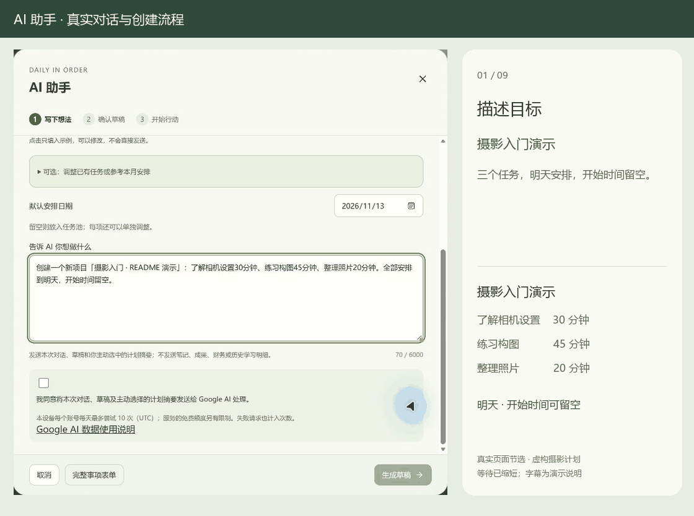
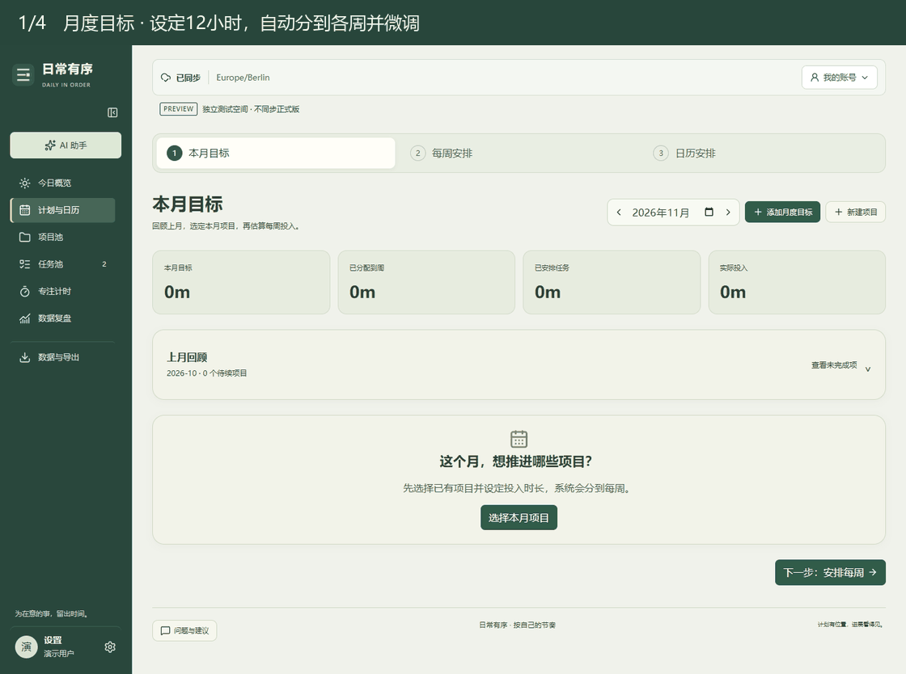

# 日常有序 · Daily in Order

**把想做的事，安排进每一天。**

从月度目标到今天的任务，把规划、专注和进度记录放在同一个工作台。

[开始使用](https://personal-daily-organize.web.app/?lang=zh) · [English](README.en.md) · [反馈与建议](https://github.com/Kylie08ky/daily-in-order/issues)

电脑端优先 · 中文 / English / Deutsch · 支持安装到桌面

<table>
<tr>
<td width="50%" valign="top">
<strong>今日概览</strong> 

 今天的安排、项目进度与随记。
</td>
<td width="50%" valign="top">
<strong>当日时间轴</strong> 

 实际投入与未来安排，在同一时间轴查看。
</td>
</tr>
</table>

## 从一个目标开始

想完成一门课程、推进个人项目，或养成阅读习惯？先把它变成一个项目，再决定这周和今天愿意投入多少时间。安排可以随时调整，已经付出的时间会留下来。

1. **注册并验证邮箱**，进入自己的工作台。
2. **告诉 AI 助手你想做什么**，核对草稿后，一次创建项目、任务和安排。也可以直接手动添加。
3. **从今天的一件事开始**：安排时间、开始专注，或者直接记录已经完成的进度。

不必一次设置所有目标。学习、阅读、习惯、健身和预算可以按需开启，之后再补充。

## 用一句话，整理出第一份计划

> 明天想开始学摄影：了解相机设置 30 分钟、练习构图 45 分钟、整理照片 20 分钟。放在同一个项目里，具体几点开始先不定。

AI 会把想法整理成可编辑的草稿，关联项目、任务与日期。检查后点击确认，计划才会加入工作台，无需再填一遍表单。

*真实 AI 操作演示，使用示例项目。你也可以让助手拆分月周计划、建立常驻任务，或调整原任务的剩余工作量。*

## 从月目标，走到每天的行动

**月度目标 → 每周分配 → 每日安排 → 专注投入 → 回顾调整**

先决定这个月要推进哪些项目、预计投入多少时间，再按当月各周天数初步分配。结合每周的固定安排，把任务放到合适的日期。

下面用一个 12 小时的设计目标，演示每周分配、安排当天任务、拖动调整时间，以及开始专注。

<table>
<tr>
<td width="50%" valign="top">
<strong>月度目标</strong> 

 按项目设定月度投入，再分配到各周。
</td>
<td width="50%" valign="top">
<strong>每周安排</strong> 

 结合每天的固定安排与可用时间继续拆解。
</td>
</tr>
</table>

### 一个任务，可以分几天完成

一个预计 6 小时的任务，可以本周做 2 小时、下周做 4 小时，不用重复创建。每次实际投入都会汇总到原任务。

- **不确定几点开始？** 只填日期和预计时长，作为灵活事项安排。
- **有明确时间段？** 切换到时间轴，拖动调整位置。
- **做了一半，发现还需要更多时间？** 重新估算剩余工作，再安排未做部分。
- **有每天都可能做的练习？** 存为常驻入口，需要时加入当天；课程期间的任务也可以阶段性保留。

移动未来安排不会改动过去的投入。用时超过预计，也不会自动把任务标为完成。

### 记一次投入，在相关模块看到进展

从今日事项开始正向或倒计时，进入全屏专注。结束后可以补充看了几个视频、读到第几页，或项目取得了什么成果；不用计时器时，也能手动记录。

**同一次活动的时间只计算一次。** 今日事项、学习、阅读和项目展示关联的记录，补填页码或成果不会重复增加用时。

<table>
<tr>
<td width="50%" valign="top">
<strong>AI 助手</strong> 

 描述计划，核对草稿后再保存。
</td>
<td width="50%" valign="top">
<strong>全屏专注</strong> 

 计时与虚拟激励并排展示。
</td>
</tr>
</table>

*专注中的「潜在财富」是随时间增长的虚拟激励，不代表真实收入。*

## 只开启你需要的模块

日程和项目是工作台的核心。其他模块可以按自己的生活与工作方式选择。

| 你想做的事 | 对应功能 |
| --- | --- |
| 看清学习投入，跟进课程 | 自定义模块与子项，分别记录时长和完成数量；查看本周、本月或历史累计 |
| 记住每本书读到哪里 | 书架、封面、当前页码和每次阅读记录，查看阅读时长与进度 |
| 保持规律作息与运动 | 习惯打卡、睡眠和训练记录，可选每日摄入与营养目标 |
| 管理日常开销 | 自定义账户、预算与币种，不同币种分别统计 |
| 回顾时间花在哪里 | 投入趋势、项目进度和专注历史，查看来源并修正记录 |
| 备份或带走记录 | JSON 备份与恢复、任务 CSV、日历 ICS 导入导出 |

<table>
<tr>
<td width="50%" valign="top">
<strong>学习模块与子项</strong> 

 周目标、实际时长与课程数量分别展示。
</td>
<td width="50%" valign="top">
<strong>阅读书房</strong> 

 书架、当前页码与本月阅读投入。
</td>
</tr>
</table>

## 使用前你可能想知道

**需要安装吗？**

直接打开[网页版](https://personal-daily-organize.web.app/?lang=zh)即可，也可以安装到桌面。目前优先支持电脑端；手机可以继续使用，但布局仍在完善。

**朋友会看到我的记录吗？**

每个人用自己的账号登录，工作台数据独立。分享应用链接不会分享你的任务和笔记。

**断网还能用吗？**

首次加载和登录需要联网。已经缓存的内容可以离线使用，修改会在应用打开并恢复联网后同步。关闭应用后，目前没有云端定时任务继续执行。

**必须使用 AI 吗？**

不用，手动添加和清单录入都保留。AI 需要联网，受安全验证与服务额度影响；生成的日期、时长与安排请在保存前核对。

**能连接微信读书吗？**

连接功能目前仅在预览环境测试，正式服务尚未开放。计划支持只读同步封面与阅读进度，不合并阅读时长。

**怎样反馈问题？**

在应用的「设置 → 问题反馈」中提交，或使用 [GitHub Issues](https://github.com/Kylie08ky/daily-in-order/issues)。告诉我们你想做什么、在哪一步遇到困难；附图前请遮住个人信息。

## 开发与项目资料

日常有序由 [Kylie](https://github.com/Kylie08ky) 设计与维护，使用 React、TypeScript、Firebase 和 PWA 构建。

- [本地运行与自行部署](docs/SETUP.md)
- [测试](tests) · [维护与发布流程](docs/MAINTENANCE.md)
- [微信读书连接说明](docs/WEREAD.md)
- [演示素材说明](docs/images/README.md)：截图与动图使用示例数据，不包含个人记录。

界面语言可在设置中切换；你填写的任务和笔记不会被自动翻译。恢复完整备份会替换当前工作台，操作前请先备份。

仓库尚未选定开源许可证；源码公开不代表授予任意再分发或商用许可。第三方依赖与素材遵循各自许可。
